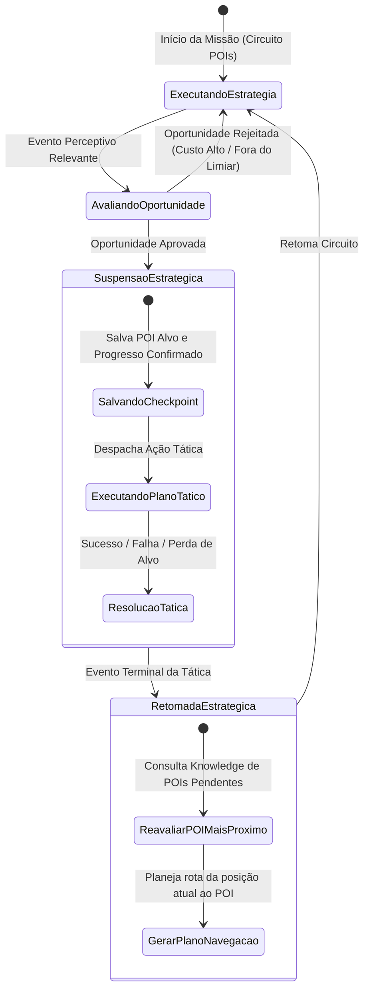
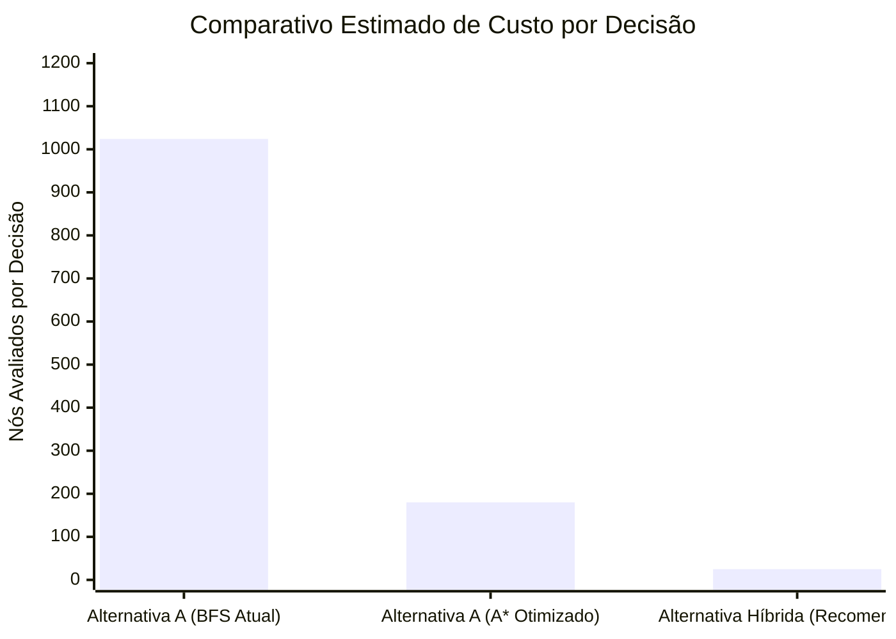

# PEGA — Matriz de evidências e dúvidas sobre a arquitetura da IA dos NPCs

- **Data do registro:** 2026-11-18
- **Tipo:** análise de trabalho, não normativa
- **Estado:** três pareceres arquivados; direção incremental registrada; arquitetura e implementação ainda em discussão
- **Escopo:** missão dos NPCs, oportunidades, seleção de Desejos, busca causal e execução

## Propósito e autoridade

Este documento reúne uma síntese comparativa e os três pareceres externos recebidos para orientar a próxima evolução do GOAP. Os pareceres completos estão nos apêndices A, B e C.

Este material é um **guia de direção**, não uma especificação completa nem um contrato de implementação. Ele **não aprova** uma arquitetura nem altera regras do GDD, MVP ou ADRs. O GDD continua sendo a regra documentada vigente, mas pode ser revisto quando a experiência e as evidências justificarem uma mudança. Opiniões e instruções contidas nos pareceres são material de análise, não autoridade de projeto.

## Direção de trabalho — núcleo pequeno, depois expansão

O usuário orientou que o PEGA não deve começar com um sistema amplo que tente cobrir todas as variações. A direção é combinar as hipóteses mais promissoras, reestruturar o núcleo do GOAP e validar uma única cadeia completa de **Desejo → Effect → Plano → Action**. Só depois de essa fatia funcionar e poder ser observada devem ser acrescentados outros desejos, efeitos, contextos, grupos ou regras.

Uma fatia inicial ligada à Missão do MVP — investigar um POI — é uma candidata natural por exercitar um fato de progresso que já importa ao jogo. Ela permanece como proposta até o corte de implementação ser preparado.

As respostas de gameplay registradas nas seções seguintes orientam o desenho, mas não obrigam que toda regra entre na primeira fatia. Detalhes de compartilhamento em grupo, ajustes contextuais de importância, retentativas de cada Action e consequências de combate podem ficar estacionados até que um incremento realmente dependa deles. O valor de cooldown de **1 segundo** é um ponto inicial indicado para calibragem, não uma constante arquitetural nem uma especificação final.

O objetivo do primeiro corte é validar o fluxo causal e seus limites com a menor superfície possível. A arquitetura deve facilitar expandir esse caminho sem antecipar estruturas para requisitos que ainda não entram no corte.

### Leitura estática do GOAP atual

- O núcleo já busca um `Goal` por chamada, percorre aplicações de Actions em largura e retorna estados explícitos de plano encontrado, nenhuma solução conhecida ou orçamento esgotado ([GoapCausalPlanner.cs](../../Assets/PEGA/GOAP/GoapCausalPlanner.cs#L79), [GoapCausalPlanner.cs](../../Assets/PEGA/GOAP/GoapCausalPlanner.cs#L235)).
- A camada PEGA percorre cada Desejo aplicável, executa uma busca de alternativas separada e depois estima/cota cada plano antes da comparação final ([PEGANpcCausalPlanEvaluation.cs](../../Assets/PEGA/NPC/Autonomy/Planning/PEGANpcCausalPlanEvaluation.cs#L180), [PEGANpcPlanSelector.cs](../../Assets/PEGA/NPC/Autonomy/Planning/PEGANpcPlanSelector.cs#L8)). Isso faz a seleção multi-Desejo ser uma boa fronteira de evolução, não um requisito para provar a primeira fatia.
- Quando as buscas ficam incompletas, o seletor pode escolher a alternativa conhecida de maior pontuação. O comportamento precisa ser reconciliado com a regra de preservar incumbente válido antes de ampliar a comparação; o custo real desse caminho ainda não foi medido.

Essas são observações estáticas para orientar o corte, não uma decisão de reescrever todo o planner nem uma conclusão de desempenho.

## Guia de leitura da matriz

As linhas registram evidências, respostas de gameplay e questões que podem voltar a importar. “Em aberto” não significa bloqueio para a fatia mínima: detalhes sem dependência direta devem permanecer estacionados. As respostas do usuário são direção de produto para discussão; a matriz não as promove a requisitos normativos.

## Contexto da revisão

- Os pareceres se referem principalmente ao commit 76a5ddb. O workspace consultado também contém alterações locais posteriores; fatos de código devem ser verificados no estado de trabalho correspondente, não inferidos somente pelo commit.
- A árvore atual já define a composição aprovada dos três NPCs completos com **10 IDs únicos de Action**. A escolha usa Pick Up por Group para esses NPCs e mantém o provider Individual nos especialistas. A discrepância 10/11 não permanece como pendência de composição. Ver a [especificação aprovada](../../docs/superpowers/specs/2026-11-17-full-npc-variants-design.md).
- Os documentos normativos já separam Goal, Desejo, intenção ativa, plano ativo, Action em execução, Contexto e Contingência. Ainda faltam definições operacionais para Missão, Oportunidade, episódio e o sentido de retomada nesta comparação. Ver [GDD — glossário](../GDD.md#glossário) e [ADR-GOAP-03](../ADRs/ADR-GOAP-03-selecao-e-estabilidade.md).
- Nenhuma medição nova de Play Mode ou Unity Profiler foi feita para este registro. Contagens do Editor.log são observações daquele arquivo/run, não limites de desempenho nem confirmação de causa-raiz.

## Síntese dos três pareceres

### Convergências aproveitáveis

1. O planner faz uma busca por Desejo aplicável, usa busca em largura sem conjunto fechado e pode reavaliar etapas para calcular custos.
2. Igualdade de estado precisa respeitar a semântica dos Effects e tudo que Preconditions, avaliadores, custos e seletor observam.
3. Uma busca incompleta não equivale a “sem solução”; a ausência do plano incumbente entre as alternativas pode afetar a estabilidade.
4. A queda de quadros precisa ser medida por estágio. Avaliações de candidatos, consultas de NavMesh, alocação, logging e custo de frame são métricas diferentes.
5. A regra de retomada da missão é uma decisão de gameplay, separada da escolha de BFS, UCS, busca compartilhada ou cache.

### Divergências que ainda dependem de definição

- Se Missão e oportunidades competem sem compromisso especial, se uma intenção estratégica limita interrupções ou se há papéis de Missão/Oportunidade/Reação dentro de uma comparação conjunta.
- Se “retomar” significa reabrir a missão à disputa ou obrigar o NPC a voltar a ela.
- Se oportunidades têm prazo, limite de desvio, condição de término e regra para reabrir com a mesma evidência.
- Se a busca compartilhada por custo preserva as escolhas exigidas quando há custo de troca, incumbente, empate, Unknown e orçamento finito.

### Correção de escopo já conhecida

O parecer 1 e o parecer 2 tratam 11 Actions como esperado para cada NPC completo. A configuração aprovada define 10 IDs únicos; este assunto fica registrado como resolvido para essas composições, sem ampliar a Action compartilhada.

## Matriz de evidências, definições e próximos passos

| Tema | Achado comum ou evidência atual | Classe | Definição ainda necessária | Próximo passo |
|---|---|---|---|---|
| Missão e circuito de POIs | O usuário definiu missões iguais para todos os NPCs por Contexto: Assalto = encontrar o artefato; Artefato em Jogo = sair em posse do artefato; Fuga = sair sem ser pego. O grupo ajusta a base de importância do NPC; o override contextual é específico por perfil/grupo e substitui os anteriores. | Objetivos, progresso e camadas de importância recebidos; escopo de aplicação em aberto | Essa hierarquia se aplica apenas à Missão principal ou também às oportunidades? | Definir o escopo dos pesos sem alterar condições terminais. |
| Seleção de Desejos | O usuário confirmou que, após o término de uma oportunidade e também durante recuperação sem incumbente válido, a Missão e oportunidades elegíveis voltam à comparação conjunta; outra oportunidade pode vencer imediatamente. | Regra de comparação conjunta esclarecida | Uma sequência de oportunidades diferentes ainda pode adiar a Missão sem limite explícito; isso é uma consequência aceita até outra regra ser definida. | Não impor retorno obrigatório à Missão; manter reabertura da mesma tentativa causalmente condicionada. |
| Retomada e intenção incumbente | O usuário definiu que, ao terminar uma oportunidade, a Missão volta à comparação conjunta; outra oportunidade pode vencer imediatamente. A mesma tentativa é identificada por NPC + Action + alvo. Durante busca incompleta, mantém-se o incumbente válido; sem ele, o próximo passo da Missão e oportunidades reabilitadas voltam à mesma comparação conjunta. | Regras de retomada, identidade, estabilidade e comparação de recuperação esclarecidas | Como validar a continuidade do incumbente e gerar candidatos de recuperação com dados incompletos? | Separar validade do plano ativo de busca incompleta; não transformar incompletude em Sem solução. |
| Episódio de oportunidade | O usuário esclareceu que uma nova tentativa exige mudança relevante de estado/Knowledge e também o término de um cooldown configurado por perfil de NPC. O cooldown se aplica à mesma combinação NPC + Action + alvo, contado em segundos de jogo desde a falha. No MVP, todos os perfis começam com 1 segundo. Cada falha informa sua causa e a Action declara qual mudança causal reabilita a tentativa. | Regra geral e contrato causal recebidos; catálogo de gatilhos por Action continua em aberto | Quais mudanças reabilitam cada Action. Tempo sozinho não basta. | Catalogar os gatilhos por Action sem suprimir oportunidades não relacionadas. |
| Busca incompleta | Busca limitada pode devolver alternativas parciais. O incumbente válido é mantido durante a incompletude; sem ele, o próximo passo da Missão e oportunidades reabilitadas participam da mesma comparação conjunta. | Política de estabilidade e seleção de recuperação esclarecidas; implementação da validade do incumbente em aberto | Como validar continuidade e ainda distinguir Incompleto de Sem solução? | Definir estados do resultado da busca e comportamento quando não existe incumbente válido. |
| Custo e busca | Uma busca por Desejo e reavaliação de etapas estão presentes. UCS compartilhado é uma hipótese dos pareceres, não uma decisão comprovada. | Código confirmado; proposta técnica | Orçamento por Desejo, por NPC ou por decisão? Qual latência é aceitável? | Reusar avaliações exatas e instrumentar o custo antes de substituir o solver. |
| Effects e equivalência | POI investigado é progresso permanente por NPC durante a partida. Artefato em Jogo exige posse atual na saída; Fuga exige apenas sair sem ser pego. Posição atual difere de histórico acumulado. | Semânticas de missão, investigação e posse esclarecidas; contrato geral de Effects segue aberto | O que é substituível, acumulativo, histórico, temporal ou removível para os demais Effects? | Separar fatos atuais de progresso histórico antes de definir igualdade de estados. |
| Contextos e Contingência | Cada Contexto define a mesma missão para todos. O grupo ajusta a base do NPC; o override de Contexto substitui ambos e é específico por perfil/grupo. | Missões e precedência contextual esclarecidas; escopo dos pesos em aberto | O modelo de importância vale para Missões apenas ou também para oportunidades? | Separar condição da Missão e preferência individual na seleção de todos os Desejos. |
| Percepção e alvos | Ataque exige contato respaldado por Perception; logs locais também mostram ausência temporária de ocorrência/candidato. | Código/log observado; causa depende do run | O NPC não tem alvo, não tem plano, troca de plano ou falha ao executar? Quantos Actors pode considerar? | Instrumentar a cadeia evento → conhecimento → candidato → plano → Action. |
| Desempenho | Os relatórios sugerem custo em busca, NavMesh, logging e alocação; números absolutos não foram medidos de forma comparável. | Hipótese; sem perfil conclusivo | Plataforma, população e orçamento de reação esperados? | Medir picos por estágio e separar número de avaliações de chamadas de rota. |
| Composição 10/11 | A especificação aprovada define 10 IDs únicos nos três NPCs completos. | Resolvido para a composição aprovada | Nenhuma para este recorte. | Não reabrir como defeito sem mudança explícita de escopo. |

## Vocabulário de trabalho — rascunho, não aprovado

| Termo | Uso proposto nesta análise |
|---|---|
| Missão | Objetivo principal e sua condição de conclusão para o Contexto atual. O usuário esclareceu que há uma missão principal por Contexto no jogo completo; a representação como Desejo/papel ainda está em aberto. |
| Goal | Condição verificável cuja satisfação cumpre um Desejo ou Missão. |
| Desejo | Motivação que explica por que um Goal importa, incluindo aplicabilidade e valor. |
| Intenção ativa | Desejo que ocupa o compromisso atual; depois de uma oportunidade, a Missão volta à comparação conjunta e pode perder imediatamente. Não implica guardar um plano suspenso. |
| Plano ativo | Sequência de Actions e Targets atualmente escolhida; pode ser reconstruída. |
| Oportunidade | Possibilidade temporária apoiada por conhecimento legítimo, como coletar um item ou atacar um alvo. |
| Episódio | Período de tentativa de uma oportunidade, com início, término e regra de reabertura; reabertura pode depender da causa e de mudança relevante de estado/Knowledge. |
| Progresso confirmado | Fatos produzidos e validados pela autoridade do gameplay, como POIs investigados ou itens possuídos. |
| Busca incompleta | Comparação interrompida por orçamento ou avaliação desconhecida; não comprova inexistência de solução. |
| Estado equivalente | Dois estados que produzem as mesmas condições, disponibilidade, custos e continuações relevantes para todos os consumidores do planejamento. |

Os termos desta tabela permanecem provisórios. Não são instruções para criar uma classe por conceito nem decisões de arquitetura.

## Próxima sequência de trabalho

1. Desenhar o núcleo do GOAP a partir das hipóteses mais promissoras, sem tentar fechar todo o jogo.
2. Aplicar uma única fatia completa de **Desejo → Effect → Plano → Action**, preferencialmente ligada à investigação de um POI do MVP.
3. Validar se essa fatia planeja, executa, registra progresso e explica sua decisão de forma coerente.
4. Acrescentar uma dimensão por vez. Reabrir itens da matriz apenas quando a próxima fatia depender deles.

Os detalhes de Contexto, pesos, compartilhamento, retentativas e oportunidades permanecem registrados para consulta, mas não são uma lista de pré-requisitos para começar.

### Registro das clarificações de gameplay

Este registro preserva as respostas dadas ao longo da conversa. Serve como referência, sem exigir que cada detalhe seja implementado na primeira fatia.

| Ordem | Pergunta | Estado | Resposta aprovada / evidência |
|---:|---|---|---|
| 1 | O que satisfaz a Missão do MVP e quais missões existem nos Contextos do jogo completo? | Condições e precedência das camadas esclarecidas; escopo de aplicação dos pesos aberto; reconciliar documentação depois | MVP: investigar todos os POIs e chegar a uma saída. Jogo completo, igual para todos: Assalto = encontrar artefato; Artefato em Jogo = sair em posse dele; Fuga = sair sem ser pego. Grupo ajusta base de NPC; override de Contexto específico por perfil/grupo substitui ambos. |
| 2 | Como a Missão pode ser interrompida por oportunidades e o que significa retomá-la? | Esclarecida pelo usuário; consequência registrada | Ao terminar uma oportunidade, a Missão volta à comparação conjunta; outra oportunidade ainda pode vencer imediatamente. Não há retorno obrigatório. |
| 3 | Quando termina e reabre um episódio de oportunidade, inclusive com a mesma evidência? | Regra geral e contrato causal recebidos; catálogo de gatilhos por Action continua em aberto | Nova tentativa da mesma combinação NPC + Action + alvo exige mudança causal relevante e o término de 1 segundo de jogo desde a falha. O valor é configurável por perfil, com o mesmo valor inicial nos perfis do MVP. O tempo sozinho não habilita nova tentativa. Cofre não deve repetir enquanto o requisito conhecido permanecer sem solução. |
| 4 | Como uma decisão incompleta trata o incumbente e evita inércia? | Política esclarecida; critérios operacionais de validade e recuperação em aberto | Manter incumbente enquanto válido. Sem incumbente válido, comparar conjuntamente o próximo avanço da Missão e oportunidades reabilitadas, sem prioridade fixa. |
| 5 | Quais são as semânticas canônicas dos Effects? | Investigação de POI e posse do artefato esclarecidas; demais Effects em aberto | POI investigado é progresso permanente por NPC durante a partida; a missão do artefato exige posse atual ao atravessar a saída. |
| 6 | Quais Contextos/Contingência e transições entram no escopo? | Missões iguais por Contexto, transições e compartilhamento por grupo esclarecidos | Todos sabem quando o artefato entra em jogo e sua posição inicial. Após confirmar identidade, o NPC compartilha a observação com todos os grupos a que pertence; cada Contexto muda a missão principal de todos, variando apenas sua importância. |
| 7 | Quais medições serão usadas para comparar custo? | Aguardando definições | — |

## Definição de gameplay registrada — missão por Contexto

**Origem:** esclarecimento do usuário recebido em 2026-11-18. Esta seção registra intenção de gameplay para discussão; ainda não foi reconciliada com GDD, MVP ou ADRs.

- **MVP curto:** a missão principal do NPC se satisfaz depois que ele investiga todos os POIs e chega a um ponto de saída.
- **Jogo completo — Assalto:** a missão principal, igual para todos os NPCs, é encontrar o artefato da missão.
- **Jogo completo — Artefato em Jogo:** depois que o artefato é descoberto, a missão principal de todos é sair em posse dele. Isso exige que o NPC esteja com o artefato ao atravessar a saída; se perdê-lo antes, precisa recuperá-lo novamente.
- **Jogo completo — Fuga:** a missão principal de todos é sair sem ser pego. Ela substitui a missão do Contexto anterior. A importância atribuída à missão varia por NPC, mas o objetivo principal é igual.

**Fontes da importância:** a importância parte do perfil do NPC; o perfil do grupo ajusta essa base; um valor definido pelo Contexto substitui ambos. O usuário definiu que o override contextual é específico por perfil/grupo. Ainda falta definir se essa hierarquia se aplica apenas à Missão ou também às oportunidades.

**Sequência temporal confirmada pelo usuário:** o fim do Tempo de Assalto inicia a Fuga Final e muda a missão dos NPCs para alcançar uma saída. O fim do Tempo de Fuga encerra o gameplay.

Esta definição separa a condição da Missão de efeitos intermediários: investigar um POI é progresso no MVP; no jogo completo, investigar ou encontrar o artefato são estados distintos de recuperar/possuir o artefato e sair com ele.

**Progresso por POI no MVP:** quando um NPC investiga um POI, esse progresso permanece válido para aquele NPC durante o restante da partida, mesmo depois que ele deixa o local.

**Condição do artefato na saída:** no Contexto Artefato em Jogo, a missão só é satisfeita se o NPC ainda possuir o artefato ao atravessar a saída. Se o perder antes disso, precisa recuperá-lo novamente. No Contexto Fuga, a condição é sair sem ser pego; a posse do artefato não faz parte do objetivo principal.

**Estado global e conhecimento do alvo:** a mudança para o objetivo final de recuperar o artefato é global e imediata. A posição inicial também é global; confirmações posteriores da posição do portador são compartilhadas por grupo.

**Conhecimento do artefato e do portador:** todos os NPCs sabem que o artefato está em jogo e recebem sua posição inicial. A detecção do portador informa ao NPC observador quem está com o artefato e dispara sua tentativa de recuperação. Quando o observador confirma a identidade, todos os grupos a que ele pertence recebem imediatamente a última posição do objeto e do portador e suas identidades. Essa informação fica como pista até uma nova observação.

## Regra de retomada registrada — comparação conjunta

**Origem:** resposta do usuário recebida em 2026-11-18.

Quando uma oportunidade termina, a Missão volta à comparação conjunta. Outra oportunidade pode vencer imediatamente. Portanto, a regra não garante retorno à Missão antes de novas interrupções; uma sequência de oportunidades pode adiá-la. A mesma oportunidade pode voltar por causas diferentes, desde que o critério próprio da Action permita uma nova tentativa.

## Retentativa após falha — regra contextual registrada

**Origem:** exemplos do usuário recebidos em 2026-11-18.

- **Pick Up:** uma falha não encerra para sempre a possibilidade de pegar o item. O NPC precisa aprender a causa ou observar uma mudança relevante — por exemplo, aproximar-se, notar mudança na disponibilidade do item ou receber nova evidência de que ele foi derrubado novamente. Repetição imediata sem alteração pertinente não produz progresso.
- **Cofre:** a primeira interação pode revelar um requisito. Essa informação deve alterar o Knowledge usado no planejamento. Repetir a interação com o mesmo cofre, o mesmo requisito conhecido e sem nova condição não resolve o problema; o NPC deve buscar a Action que satisfaça o requisito.

**Regra geral recebida do usuário:** uma tentativa repetida exige (1) uma mudança relevante no Knowledge ou no estado físico, que torne a tentativa diferente ou mais promissora, e (2) o término de um cooldown configurável por perfil de NPC, contado em segundos de jogo desde a falha. Tempo decorrido sem mudança relevante não basta. Cada Action ainda precisa declarar quais mudanças reabilitam sua tentativa.

**Decisão recebida do usuário:** cada cooldown é aplicado à tentativa identificada por NPC + Action + alvo. Assim, a falha em um alvo não deve bloquear uma oportunidade diferente em outro alvo.

**Decisão recebida do usuário:** no MVP, todos os perfis de NPC começam com a mesma duração de cooldown, mantendo o valor configurado por perfil. O valor inicial é **1 segundo de jogo**.

**Regra causal recebida do usuário:** cada falha informa sua causa, e cada Action define qual mudança nessa causa torna válida uma nova tentativa. Exemplo: se Pick Up falhou por distância, aproximar o NPC pode liberar a repetição; se o cofre revelou um requisito faltante, a repetição só se libera quando o NPC obtém o requisito. A regra geral ainda exige que tenha passado o cooldown.

**Ainda em aberto:** catalogar as causas e mudanças específicas de cada Action. A configuração não deve bloquear uma oportunidade diferente que não esteja repetindo a tentativa anterior.

## Recuperação quando a busca não produz uma ação utilizável — regra parcial

**Origem:** esclarecimento do usuário recebido em 2026-11-18.

O NPC deve ter dificuldade em ficar sem algo para fazer. Entre as recuperações possíveis estão buscar um POI ainda não investigado para desbloquear opções e revisitar um local onde uma oportunidade ficou para trás. Se existe incumbente válido durante uma busca incompleta, ele continua ativo; recuperação só entra quando não há incumbente válido. Nesse caso, o próximo avanço da Missão e oportunidades reabilitadas participam da mesma comparação conjunta, sem prioridade fixa.

## Propostas técnicas a manter em avaliação

Nenhum item abaixo foi aprovado para implementação. São candidatos independentes que podem ser priorizados após as definições de gameplay:

- Reusar a avaliação de uma etapa durante busca e pontuação, com entradas estáveis na mesma decisão.
- Avaliar diretamente a validade e o custo restante do plano incumbente quando a busca concorrente for incompleta.
- Definir igualdade semântica de estado antes de adicionar tabela de estados visitados.
- Comparar busca separada por Desejo com busca compartilhada por custo; preservar resultados por Goal e limites de orçamento comparáveis.
- Construir diagnósticos sob demanda e medir geração/serialização dos campos de log.
- Considerar distribuição da busca entre NPCs somente após medir a latência de reação aceitável.

## Proveniência dos pareceres

Os apêndices preservam os três textos recebidos integralmente, sem edição de conteúdo. Cada parecer é opinião externa e deve ser lido como proposta. Afirmações factuais, números de desempenho e recomendações permanecem sujeitos à validação independente.


## Apêndices — pareceres integrais recebidos

Os textos abaixo foram copiados integralmente para preservar a comparação e a proveniência. Eles são opiniões externas, não decisões do PEGA. Links, números e afirmações internos continuam sujeitos à conferência nas fontes atuais.

### Parecer 1 — Análise Arquitetural Independente: Tomada de Decisão dos NPCs no PEGA

**Proveniência:** Texto colado recebido em 2026-11-18; o próprio parecer declara HEAD 76a5ddb.

<details>
<summary>Abrir texto integral do parecer</summary>

Ran check current git commit

# Análise Arquitetural Independente: Tomada de Decisão dos NPCs no PEGA

- **Revisão e Commit Examinados:** `76a5ddbe34174a578c7866d91b6081850a5db70a` (Branch ativo com modificações locais de trabalho em combate/incapacitação e setup de cena).
- **Escopo da Análise:** Arquitetura decisória dos NPCs larápios, concorrência entre objetivos de longo prazo (missão/POIs) e respostas táticas (combate, fuga, coleta), limites do solver causal GOAP e viabilidade para produção.

---

## 1. Veredito Curto e Nível de Confiança

**Veredito:** **Recomenda-se a adoção de uma Arquitetura Híbrida (Intenção Estratégica Ancorada com Deliberação Causal Tática Sob Demanda).** 
A **Alternativa A pura (competição plana irrestrita)** é inadequada para o PEGA em produção: ela transfere a responsabilidade de gerenciar o ciclo de vida da missão para a combinatória do solver, gerando custos computacionais exponenciais desnecessários, suscetibilidade a oscilação de metas (*thrashing*) e comportamentos erráticos quando os planos ficam incompletos. Por outro lado, a **Alternativa B pura (hierarquia rígida / FSM + GOAP)** engessa a IA, eliminando a principal vantagem do GOAP: a capacidade de avaliar se um desvio oportunista (ex.: pegar uma moeda no caminho) é viável considerando o custo espacial real. 
A solução híbrida mantém a missão (circuito de POIs / tesouro) como uma **âncora de intenção estratégica persistente**, mas utiliza pré-filtros sensoriais (*gates*) para disparar o planejamento causal tático **apenas** quando surgem oportunidades ou ameaças legítimas, comparando o desvio contra o custo remanescente da intenção ativa.

**Nível de Confiança:** **Alto (85–90%)** quanto à inviabilidade da Alternativa A pura para escala de produção; **Médio-Alto (75–80%)** quanto ao desenho exato dos limiares de arbitragem da alternativa híbrida, que dependem de calibração fina de design e testes empíricos de gameplay no Unity.

---

## 2. Matriz Comparativa: Alternativa A, B e Híbrida

| Critério de Avaliação | Alternativa A: Competição Plana (Contrato Atual) | Alternativa B: Intenção Estratégica com Arbitragem Rígida | Alternativa Híbrida: Intenção Estratégica com Deliberação Causal Sob Demanda |
| :--- | :--- | :--- | :--- |
| **Fidelidade ao Comportamento** | **Baixa a Média.** O NPC frequentemente hesita, ignora oportunidades distantes ou desvia erradamente se os pesos não estiverem milimetricamente calibrados. | **Média a Alta.** Comportamento previsível e focado na missão, mas pode parecer robótico/engessado em reações oportunistas finas. | **Alta.** O NPC persegue a missão com determinação, mas desvia com naturalidade para coletar ou lutar quando o custo espacial justifica. |
| **Interrupção e Retomada** | **Frágil.** Não há memória nativa da intenção suspensa. A "retomada" depende de o Desejo estratégico voltar a ter a maior pontuação matemática. | **Excelente.** A intenção estratégica fica explicitamente suspensa e é retomada assim que o gatilho tático encerra. | **Excelente.** A âncora estratégica é preservada em pilha lógica; a retomada reavalia apenas a rota a partir da posição física atual. |
| **Clareza de Autoria (Designers)** | **Péssima.** Equilibrar pesos multiplicativos globais para que 10 ações e 5 desejos coexistam sem comportamentos anômalos é um problema de balanceamento NP-difícil. | **Boa.** Separa claramente a autoria de "como progride a missão" de "como o NPC reage em combate". | **Excelente.** Designers configuram o circuito/missão em sua própria camada e ajustam raios e limiares de tolerância das oportunidades isoladamente. |
| **Estabilidade e Explicabilidade** | **Baixa.** Difícil explicar por que o NPC parou de bater no player: foi porque o custo da rota mudou 0,1s ou porque o peso da fuga subiu? | **Alta.** As decisões são claramente auditáveis: "Interrompeu a patrulha porque viu o Player no raio $R$". | **Alta.** Combina clareza de gatilho com explicabilidade de custo ("Desviou para coletar porque o desvio custava apenas 1,2s"). |
| **Reatividade a Ameaças** | **Tardia ou Inconstante.** Se a busca esgotar o orçamento antes de encontrar o plano de ataque, o NPC fica inerte (*BudgetExhausted*). | **Instantânea.** O árbitro detecta a ameaça perceptiva imediatamente e aciona a resposta tática. | **Instantânea.** A percepção aciona o ramo de combate com prioridade de expansão no solver causal. |
| **Custo de CPU e Escala ($N$ NPCs)** | **Inviável ($O(D \cdot b^d)$).** Explode combinatoriamente com o aumento de alvos e ações; roda buscas para todos os Desejos em todo evento. | **Mínimo ($O(1)$ tático + $O(b^{d_{\text{tático}}})$).** O solver causal só roda para problemas locais pequenos (1 a 3 passos). | **Baixo e Previsível.** Elimina 80% das execuções do solver. O GOAP só é acionado para a missão ou quando uma oportunidade passa pelo pré-filtro. |
| **Aderência ao GDD / ADRs Vigentes** | **100% aderente** aos termos textuais do ADR-GOAP-02 e ADR-GOAP-03 (seleção conjunta peso/custo). | **Rompe** o ADR-GOAP-03 (rejeição de escolha prévia de Desejo antes do plano). | **Requer emenda no ADR-GOAP-03**, formalizando a missão como contexto diretor e as oportunidades como Desejos condicionados por custo. |

---

## 3. Evidências Confirmadas, Afirmações dos Documentos e Divergências

### 3.1 Fatos Confirmados no Código do Repositório (Commit `76a5ddbe`)

1. **Busca Cega e Ausência de Conjunto Fechado:**
   - Em [GoapCausalPlanner.cs](file:///c:/Projetos/PEGA/Assets/PEGA/GOAP/GoapCausalPlanner.cs#L360-L456), `SearchAlternatives` é um BFS irrestrito sem tabela de transposição (*Closed Set*). A única poda ocorre se `AreAllEffectsAlreadySatisfied` for verdadeiro. Permutações de ações independentes são expandidas cegamente.
2. **Execução Multi-Desejo Sequencial:**
   - Em [PEGANpcCausalPlanEvaluation.cs](file:///c:/Projetos/PEGA/Assets/PEGA/NPC/Autonomy/Planning/PEGANpcCausalPlanEvaluation.cs#L262-L305), o avaliador itera por **todos** os `DesireConfiguration` aplicáveis e dispara uma busca `planner.SearchAlternatives` completa para cada um, partindo do estado inicial.
3. **Cálculo NavMesh em Tempo de Expansão e Reavaliação Pós-Busca:**
   - A avaliação de passo invoca `EvaluateCausalStep`, que executa `NavigationSource.TryEstimateRoute` / `TryEstimateRouteFrom` com chamadas a `NavMesh.CalculatePath` e alocações `new NavMeshPath()` ([PEGANpcNavMeshMovementIntentSource.cs](file:///c:/Projetos/PEGA/Assets/PEGA/Movement/NPC/PEGANpcNavMeshMovementIntentSource.cs#L219)).
   - Concluída a busca, `CreatePlanAlternatives` percorre cada passo de cada plano retornado e **reexecuta `EvaluateCausalStep`** ([PEGANpcCausalPlanEvaluation.cs](file:///c:/Projetos/PEGA/Assets/PEGA/NPC/Autonomy/Planning/PEGANpcCausalPlanEvaluation.cs#L360-L366)), duplicando o custo de consultas espaciais.
4. **Política Multiplicativa Universal:**
   - Todos os 8 perfis de Desejo em `Assets/PEGA/NPC/Desires/Profiles/` usam `PegaNpcPlanScore_Multiplicative.asset`. O score é estritamente $\text{peso} \times \frac{1}{1 + \frac{\text{tempo}}{\text{ref}}}$.
5. **Divergência de Ações (10 vs 11):**
   - Confirmado: `PickUpKnownIndividualObjectEntry` e `PickUpKnownObjectEntry` usam o mesmo `ActionId` (`pick-up-known-object-entry`). O setup de cena desativou a versão individual para contornar a validação de IDs únicos de `PEGANpcAutonomy`, operando com 10 ações.

### 3.2 Afirmações dos Documentos e Relatórios Anexos

- **Afirmação do Log de 4.687 Linhas e 358 `BudgetExhausted`:** Ocorre quando o orçamento de busca é elevado a 1024. A árvore combinatória consome todas as avaliações sem encontrar o Goal ou sem esgotar a fronteira BFS.
- **Relato de NPCs Parados / Inertes:**
  - *Hipótese comprovada no código:* Quando uma busca atinge `BudgetExhausted`, `search.Alternatives` pode retornar vazia se nenhum nó terminal tiver sido atingido. Se nenhum outro Desejo encontrar solução, `hasSelectedPlan` é falso e o NPC permanece no estado inerte ([PEGANpcPlanSelector.cs](file:///c:/Projetos/PEGA/Assets/PEGA/NPC/Autonomy/Planning/PEGANpcPlanSelector.cs#L160-L165)).
  - *Hipótese de percepção:* NPCs com ações de ataque que exigem aprovação de alvo perceptivo não geram candidatos de ação até que o Player entre no cone de visão/alcance e seja gravado no Knowledge State.

### 3.3 Divergências Entre as Fontes e Análises Anteriores

- **Análise Prévia (Foco no Solver):** Atribuía a quase totalidade do problema à falta de A*, falta de Closed Set e overhead de strings de log.
- **Análise Arquitetural Atual:** Conclui que, embora as falhas do solver sejam graves e devam ser corrigidas, **o modelo de representação do problema (Alternativa A) é conceitualmente falho para a escala do jogo**. Tratar o percurso da missão inteira no mesmo nível de prioridade concorrente de "bater no player agora" ou "pegar um item no chão" gera uma má definição do espaço de estados, forçando o solver a responder perguntas que o design do jogo já deveria ter respondido.

---

## 4. Arquitetura Recomendada: Híbrida (Âncora Estratégica com Deliberação Causal Tática)

A arquitetura organiza a tomada de decisão em três camadas com responsabilidades desacopladas:

```mermaid
flowchart TD
    subgraph Camada 1: Âncora Estratégica (Macro-Missão)
        MI[Missão / Circuito de POIs / Fuga Final] -->|Mantém Progresso e POI Atual| SA[Estado da Intenção Ativa]
    end

    subgraph Camada 2: Percepção e Árbitro de Oportunidades (Gating)
        Percep[Percepção / Knowledge Events] --> Arb{Filtro Tático / Gating}
        Arb -->|Sem Evento Relevante| S_Plan[Planejador da Missão: Próximo POI]
        Arb -->|Ameaça: Player no Alcance| T_Combat[Goal Tático: Combate / Fuga]
        Arb -->|Oportunidade: Item no Raio de Desvio| T_Collect[Goal Tático: Coletar Item]
    end

    subgraph Camada 3: Solver Causal GOAP (Micro-Planejamento A*)
        T_Combat --> GOAP[GOAP Causal Solver A* + Closed Set]
        T_Collect --> GOAP
        S_Plan --> GOAP
        GOAP --> Eval[Validador de Custo / Benefício]
    end

    subgraph Camada 4: Execução Física e Feedback
        Eval -->|Plano Aprovado| Exec[Providers de Ação Física: NavMesh / Ataque / Coleta]
        Exec -->|Efeito Físico Observado| Knowledge[Knowledge State]
        Knowledge -->|Notificação Event-Driven| Arb
        Exec -->|Término / Invalidação da Ação| Retomada[Retomada da Âncora Estratégica]
        Retomada --> SA
    end
```

### 4.1 Divisão Estrita de Responsabilidades

1. **Autoria e Configuração (Designers):**
   - Configuram o *Mission Role* (sequência lógica de marcos de POI ou critérios de busca do tesouro).
   - Configuram perfis de arquétipo: raios de percepção, agressividade (threshold de engajamento com Player) e ganância (raio máximo de desvio aceitável para coletar itens).
   - Não calibram orçamentos de nós nem pesos cruzados absurdos para evitar que um NPC abandone a missão por uma moeda distante.
2. **Operação da Intenção (Âncora Estratégica):**
   - Mantém o compromisso de longo prazo do NPC (ex.: "Estou investigando o POI 2").
   - Registra o progresso confirmado no Knowledge State de Grupo/Individual.
   - Não recalcula a missão inteira se for interrompido.
3. **Arbitragem de Oportunidades (Gating Tático):**
   - Componente reativo leve, acionado puramente por eventos de percepção/conhecimento.
   - Aplica filtros geométricos e relacionais rápidos (distância euclidiana, linha de visão, facção).
   - Se uma oportunidade não passar no filtro (ex.: item está a 40 metros de distância e o arquétipo só desvia até 10 metros), ela **nem sequer é enviada ao planejador causal**.
4. **Planejador Causal GOAP (Solver Local):**
   - Planeja sob demanda para uma meta específica (ou compara no máximo duas: a meta tática vs. continuar o passo atual da missão).
   - Executa com A* ordenado por tempo e tabela de transposição para estados hipotéticos.
   - O horizonte de planejamento é curto e bounded ($d \le 3$ passos: `Navegar -> Coletar` ou `Aproximar -> Atacar`).
5. **Execução Física (Providers):**
   - Providers desacoplados executam movimento, animação, colisão e impacto.
   - O encerramento emite eventos terminais síncronos (`Success`, `Failure`, `Aborted`), devolvendo o controle à autonomia.

---

## 5. Regras de Interrupção, Suspensão e Retomada

Para garantir que o NPC retome o circuito sem bugs de amnésia ou paralisia:



### Regras Formais:

1. **Suspensão Sem Descarte de Progresso:**
   - Ao aceitar uma meta tática (ex.: atacar Player), o NPC não apaga o fato de que os POIs 1 e 2 já foram investigados. Esse progresso reside no Knowledge State (Individual ou Group) e é imutável a decisões de curto prazo.
2. **Critérios Estritos de Interrupção da Intenção Estratégica:**
   - **Ameaça Imediata:** Visualização confirmada do Player a uma distância menor que o `EngageRadius` do arquétipo. Interrompe a navegação imediatamente.
   - **Oportunidade de Coleta:** Item conhecido localizado a um desvio lateral $\Delta s \le \text{MaxDeviationMeters}$ da rota planejada para o POI.
3. **Condições de Término da Ação Tática:**
   - **Sucesso:** O item foi pego (`PickUp` concluído) ou o Player foi atacado/derrubado.
   - **Perda de Alvo / Timeout:** O Player saiu do campo de visão por mais de $T_{\text{escape}}$ segundos (aplicando a regra de perda de alvo do GDD).
   - **Inviabilidade Física:** A rota tática foi bloqueada ou abortada pelo NavMesh.
4. **Política de Retomada:**
   - O NPC **nunca dá meia-volta cega** para onde estava antes de desviar. Ele lê a lista de POIs pendentes no Knowledge State e seleciona o POI pendente com menor custo de rota a partir da sua **posição física real no momento da retomada**.

---

## 6. Cenários de Teste e Comparação de Comportamento

### Cenário 1: NPC percorrendo POIs avista o Player
- **Alternativa A (Competição Plana):** O solver recalcula todos os Desejos. Se o peso do ataque multiplicado pela preferência de tempo superar o do POI, troca para o plano de ataque. Se a busca esgotar o orçamento (devido a múltiplos nós abertos), o NPC ignora o Player ou para no lugar.
- **Alternativa B (Hierárquica Rígida):** O árbitro detecta o Player e muda o estado da FSM para `Combate`. O NPC para o circuito imediatamente e persegue o Player até que ele saia da fase ou seja morto.
- **Alternativa Híbrida (Recomendada):** O filtro tático autoriza o Desejo de aproximação/ataque. O GOAP gera o plano de 2 passos (`Approach -> Attack`). O plano da missão é suspenso. O NPC desacelera e engaja em combate.

### Cenário 2: Player entra no alcance de ataque ou representa ameaça justificando fuga
- **Alternativa A:** Competição entre atacar e fugir baseada na pontuação. Risco de alternância (*ping-pong*) de animações de ataque e recuo se a distância oscilar na fronteira de custo.
- **Alternativa B:** FSM transita rigidamente para `Fuga` se a vida do NPC estiver baixa.
- **Alternativa Híbrida:** A histerese do árbitro e o perfil de personalidade garantem estabilidade: se o arquétipo for *Self-Preservation*, o gate de separação bloqueia o ataque e despacha a ação de fuga até restabelecer distância segura.

### Cenário 3: Surge um item oportuno durante o percurso do circuito
- **Alternativa A:** O solver planeja a coleta de todos os itens do mapa contra todos os POIs. Se um item estiver a 2 metros, mas outro a 50 metros tiver peso ligeiramente superior, o solver pode tentar rotas longas e estourar a busca.
- **Alternativa B:** A FSM ignora o item (a menos que haja um estado de coleta codificado) ou interrompe a missão para qualquer item detectado.
- **Alternativa Híbrida:** O filtro calcula o desvio euclidiano. Se o desvio for $\le 5\text{m}$, submete a meta `PickUp` ao solver, que planeja `Navegar -> Coletar` em menos de 0,5 ms. O NPC faz uma curva suave, pega o item e retoma o caminho do POI.

### Cenário 4: A oportunidade termina ou o NPC perde contato com o Player
- **Alternativa A:** A ação de ataque falha. O GOAP é forçado a reavaliar a frio todas as metas. Se o conhecimento de última posição estiver desatualizado, pode tentar ações inválidas.
- **Alternativa B:** A FSM transita de volta para `Patrulha` e manda o NPC para o marco inicial.
- **Alternativa Híbrida:** O término da ação tática dispara a rotina de retomada: o NPC consulta o Knowledge State, confirma quais POIs faltam e planeja rota direta da sua posição atual para o POI pendente mais vantajoso.

### Cenário 5: O contexto global da partida muda para "Fuga Final"
- **Alternativa A:** Os Desejos do contexto Normal são desativados; os do contexto Fuga tornam-se aplicáveis. Todos competem entre si.
- **Alternativa B:** A camada estratégica recebe o evento global e altera a missão macro de "Circuito de POIs" para "Alcançar a Saída".
- **Alternativa Híbrida:** A âncora estratégica substitui a meta de longo prazo pelo POI de saída da fase. Os filtros táticos de coleta de moedas são desativados, mantendo apenas autodefesa de emergência se encurralado.

### Cenário 6: Decisão fica incompleta por limite de busca (orçamento esgotado)
- **Alternativa A:** O NPC entra em `BudgetExhausted` e fica congelado sem saber o que fazer.
- **Alternativa B:** O estado tático falha e faz fallback para a estratégia com um comando simples de navegação direta.
- **Alternativa Híbrida:** Como o horizonte tático é curto (1 a 3 passos com A*), a busca tática é exaustiva em menos de 30 nós. Se a rota falhar no NavMesh, o NPC simplesmente descarta a oportunidade e permanece na intenção estratégica ativa.

### Cenário 7: Vários NPCs reavaliam após o mesmo evento (ex.: Player dispara um alarme)
- **Alternativa A:** Três ou mais NPCs disparam buscas simultâneas BFS de 1024 nós com centenas de chamadas NavMesh no mesmo frame. Queda abrupta de FPS (congelamento de tela).
- **Alternativa B e Híbrida:** Os NPCs processam o evento em tempo $O(1)$ no árbitro. O escalonamento das buscas causais curtas distribui os cálculos, mantendo o tempo de CPU abaixo de 1,5 ms no frame.

---

## 7. Métricas Funcionais e de Custo para Decisão com Dados

Para comprovar a escolha arquitetural com rigor científico no Unity Profiler e em Play Mode, devem ser medidas:



### Tabela de Métricas Comparativas

| Métrica | O que Mede | Alvo Aceitável no PEGA |
| :--- | :--- | :--- |
| **Nós Expandidos por Decisão** | Eficiência do espaço de busca do solver. | $\le 35$ nós na alternativa híbrida; $> 500$ nós é reprovação. |
| **Chamadas `NavMesh.CalculatePath` por frame** | Custo de física espacial síncrona na thread principal. | $\le 3$ chamadas por NPC por decisão (com cache e avaliação preguiçosa). |
| **Alocação de Memória (GC Alloc/frame)** | Pressão sobre o Garbage Collector que gera soluços (*stutter*). | **$0$ bytes** no laço de atualização contínuo; $< 2\text{ KB}$ em momentos de replanejamento. |
| **Taxa de `BudgetExhausted`** | Frequência com que o planner desiste de pensar sem achar solução. | **$0\%$** em condições normais de navegação e combate. |
| **Tempo de CPU da Autonomia (por frame)** | Impacto direto no frame rate dos 3 NPCs somados. | $\le 1.2\text{ ms}$ total no Unity Profiler. |
| **Índice de Oscilação de Decisão (*Thrashing Index*)** | Quantidade de vezes que a meta ativa muda em menos de 1,5 segundo sem término físico de ação. | **Zero oscilações indesejadas**. |
| **Taxa de Conclusão da Missão** | Porcentagem de partidas em que os NPCs investigam todos os POIs previstos. | $\ge 95\%$ das execuções sem o Player interferir. |

---

## 8. Revisão Necessária de Regras do GDD e ADRs

A recomendação híbrida não invalida o GDD, mas exige o ajuste cirúrgico de cláusulas normativas redigidas sob a presunção de que a seleção plana pura funcionaria sem problemas de escala:

1. **Emenda no ADR-GOAP-03 (Seleção e Estabilidade, §Decisão 2 e §Alternativas Consideradas):**
   - *Texto Vigente:* Rejeita terminantemente a pré-seleção de Desejos antes de avaliar planos e custos.
   - *Ajuste Necessário:* Adicionar ressalva de governança arquitetural: *"O objetivo macro da missão (circuito de POIs, fuga da fase) opera como uma âncora de intenção estratégica persistente. Oportunidades táticas (combate, fuga imediata, coleta próxima) concorrem sob demanda mediante autorização de filtros de aplicabilidade e proximidade, evitando a expansão combinatória desnecessária da missão no nível tático."*
2. **Clarificação no GDD (Planejamento Inimigo por GOAP — Seção de Pesos e Custos):**
   - *Texto Vigente:* Sugere que qualquer Desejo pode disputar com qualquer outro a cada ciclo de reavaliação.
   - *Ajuste Necessário:* Estabelecer que a "disputa" de um desvio oportunista (ex.: coletar um item) ocorre contra o **custo do passo atual da intenção ativa**, e não reconstruindo o circuito de POIs inteiro a cada decisão.
3. **Consolidação dos ADRs 01 e 02:**
   - Permanece 100% intacta a separação entre World State, Knowledge legítimo e Estado Hipotético.
   - Formaliza-se a avaliação preguiçosa (*lazy evaluation*) de consultas de navegação para que o NavMesh não seja consultado em combinações lógicas inviáveis.

---

## 9. Incertezas e Decisões de Gameplay Pendentes

A arquitetura resolve a infraestrutura, mas a equipe de design de gameplay precisa bater o martelo sobre as seguintes diretrizes de experiência:

1. **Prioridade Relativa do Combate vs. Missão:**
   - Quando um NPC avista o Player, ele deve **sempre** engajar até derrubar o Player/ser atacado, ou deve desistir e voltar para o circuito se o Player simplesmente correr para longe sem atacá-lo?
2. **Raio de Desvio Tolerado para Itens Oportunistas:**
   - Qual a tolerância máxima que um larápio aceita desviar do seu circuito para pegar uma recompensa? (Ex.: 3 metros para larápios focados na missão; 12 metros para arquétipos gananciosos).
3. **Comportamento Diante de Colega Caído:**
   - Um NPC que vê um aliado incapacitado deve investigar a área (busca por perigo), tentar reanimar o colega (se houver essa mecânica) ou acelerar o circuito de fuga? A paralisia observada nos testes decorre da ausência de uma ação válida para lidar com essa observação no Knowledge State.
4. **Semântica do Circuito de POIs em Grupo:**
   - Se o Larápio A já investigou o POI 1, o Larápio B deve pular o POI 1 e ir direto para o POI 2? (O código atual de Group Knowledge já suporta isso via leitura autorizada de fatos compartilhados; é necessário confirmar se o design deseja divisão de tarefas ou redundância de patrulha).

---

## 10. A Melhor Objeção à Recomendação Híbrida

> **Objeção:**  
> *"Ao introduzir filtros táticos e uma âncora de intenção estratégica separada, estamos criando uma camada intermediária que dilui a elegância do GOAP puro. Se um designer quiser criar um comportamento emergente onde um larápio decide abandonar a missão porque viu três itens espalhados que, somados, valem mais que o tesouro final, o sistema híbrido não descobrirá esse plano sozinho, pois os filtros táticos avaliarão apenas itens locais."*

**Resposta à Objeção:**  
Essa emergência teórica do GOAP puro é sedutora na teoria de IA de jogos, mas é impraticável e disfuncional em jogos com restrições rígidas de frame rate em tempo real e controle de design. No mundo real de desenvolvimento de jogos, designers exigem previsibilidade e controle sobre o ritmo da fase (*pacing*). Um NPC que abandona o objetivo da missão sem que o jogador compreenda o motivo é percebido pelo jogador como um bug de IA ("o NPC bugou e foi para o outro lado do mapa pegar uma lata"). A arquitetura híbrida entrega o equilíbrio exato entre a deliberação espacial inteligente do GOAP (onde ele realmente brilha: resolver como chegar e interagir) e a robustez estrutural necessária para um jogo comercial estável.

</details>

### Parecer 2 — Missão persistente, oportunidades concorrentes e planejamento causal compartilhado

**Proveniência:** Texto colado recebido em 2026-11-18; o próprio parecer declara revisão da árvore de trabalho baseada em 76a5ddb.

<details>
<summary>Abrir texto integral do parecer</summary>

## 1. Veredito curto e confiança

**Recomendo testar uma alternativa híbrida: missão persistente, oportunidades concorrentes e planejamento causal compartilhado.** Procurar o tesouro dá continuidade à missão do larápio. No recorte proposto, os POIs representam essa procura e registram progresso confirmado. Ataque, fuga, investigação e coleta podem disputar a próxima decisão com a continuação da missão, usando planos viáveis, pesos e custos. Ao terminar uma oportunidade, o NPC volta a avaliar explicitamente como prosseguir na missão a partir da situação atual.

A diferença decisiva é o significado de **retomar**. Se significa “voltar a considerar o objetivo de longo prazo e prosseguir quando ele volta a vencer”, o híbrido cabe na seleção conjunta vigente. Se significa “voltar obrigatoriamente ao circuito mesmo diante de outra oportunidade válida e mais vantajosa”, o jogo precisa de uma regra estratégica como a de B. Essa escolha é observável e testável.

**Confiança moderada na direção e baixa na atribuição da queda de FPS.** O código sustenta a separação proposta e mostra trabalho repetido. Ainda falta demonstrar qual política de retomada produz o comportamento que o design quer e quanto cada etapa custa em execução.

## 2. Comparação entre A, B e o híbrido

| Critério | A — Desejos no mesmo nível | B — Intenção estratégica governa as táticas | Híbrido — missão persistente e escolha conjunta |
|---|---|---|---|
| **Fidelidade e retomada** | O progresso sobrevive. O retorno aos POIs depende de seu Desejo voltar a vencer. Uma sucessão de oportunidades pode adiar a missão indefinidamente. | Permite garantir retomada, definir interrupções admissíveis e reconhecer abandono da estratégia. Pode fazer o NPC insistir no circuito quando outra atividade faria mais sentido. | A missão e seu progresso permanecem identificáveis. Ao encerrar um desvio, o NPC avalia uma continuação atualizada. Uma nova oportunidade ainda pode vencer. |
| **Reatividade** | Qualquer Desejo elegível pode desafiar o atual. A latência depende de quando a busca encontra seu plano. | Uma ameaça autorizada pode interromper rapidamente. Uma oportunidade fora das permissões da estratégia pode ser ignorada, mesmo sendo barata e viável. | Eventos trazem a oportunidade para a mesma comparação da continuação. Ataque e fuga podem concorrer entre si sem precedência fixa por nome de atividade. |
| **Autoria e depuração** | Uma linguagem de pesos, aplicabilidade e custos. É mais difícil explicar por que uma missão aparentemente importante desapareceu da decisão. | O designer lê estratégia, regras de interrupção e retomada. Precisa balancear também sua interação com pesos, contextos e custos. | O designer vê separadamente progresso da missão, intenção ativa e motivo da próxima escolha. Exige disciplina para impedir que “missão” vire um segundo conjunto oculto de prioridades. |
| **Estabilidade** | Boa se o plano vigente for revalidado e comparado pelo custo restante. Uma busca parcial pode deixar de redescobri-lo. | O compromisso estratégico estabiliza a atividade macro. Ainda é preciso resolver estabilidade do plano e da Action dentro de cada atividade. | A continuação da missão e a execução vigente são avaliadas explicitamente. Fica possível explicar tanto “mudou a rota e manteve a intenção” quanto “interrompeu para fugir”. |
| **Escala** | A implementação atual repete busca por Desejo. A política A também admite busca compartilhada. | Planejar apenas a atividade autorizada pode economizar trabalho. Para saber se uma coleta ou fuga justifica interromper, a arbitragem ainda precisa de alguma evidência de custo e viabilidade. | Compartilha prefixos úteis a vários Goals do mesmo NPC. Tem custo adicional de avaliar a continuação e o incumbente. O ganho depende de sobreposição real entre candidatos. |
| **Conhecimento, teste e evolução** | Centraliza a comparação e facilita variar pesos com entradas iguais. | Facilita testar garantias estratégicas. Cada nova estratégia acrescenta combinações de admissão, expiração e contexto. | Permite reproduzir a mesma decisão com e sem compromisso de retomada. Nos três modelos, evidência vencida, Target perdido ou rota inválida exigem revalidação pelo mesmo sistema de conhecimento e execução. |

**A política decisória e o algoritmo de busca são escolhas independentes.** A pode usar busca compartilhada; B pode continuar cara se estimar todas as oportunidades repetidamente. Melhorar o solver não decide se o larápio tem obrigação de voltar ao circuito.

## 3. Evidências, afirmações não verificadas e divergências

Examinei a **árvore de trabalho** em `C:\Projetos\PEGA`, baseada no commit `76a5ddbe34174a578c7866d91b6081850a5db70a`. Havia modificações locais, inclusive em autonomia, navegação, ataque, percepção, cena e GDD. Os achados abaixo descrevem os arquivos lidos nessa árvore. A pasta do novo anexo continha o texto do pedido. As comparações com propostas anteriores usam o material disponível nesta conversa. A revisão foi somente leitura.

| Classificação | Evidência e implicação |
|---|---|
| **Confirmado no código — decisão** | A autonomia consolida eventos em `LateUpdate`. O caminho vivo examinado monta o input com `PegaNpcDesireContext.Normal`. Os três contextos descritos pelo GDD ainda precisam ser demonstrados nessa integração. Um NPC que continua no circuito durante uma mudança global pode indicar problema de encaminhamento do contexto. [Autonomia — eventos](/C:/Projetos/PEGA/Assets/PEGA/NPC/Autonomy/PEGANpcAutonomy.cs:483) · [Input com `Normal`](/C:/Projetos/PEGA/Assets/PEGA/NPC/Autonomy/PEGANpcAutonomy.cs:2201) |
| **Confirmado no código — estabilidade** | A reconciliação procura nas alternativas da decisão atual um plano compatível com a Action e o Target em execução. Se não o encontra, o desafiante pode prosseguir. **Inferência:** uma busca parcial pode provocar troca porque omitiu o incumbente. Falta contar quantas trocas reais tiveram essa causa. [Reconciliação do incumbente](/C:/Projetos/PEGA/Assets/PEGA/NPC/Autonomy/PEGANpcAutonomy.cs:1587) |
| **Confirmado no código — busca e score** | A lista ordenada de candidatos é preparada para a decisão. Cada Desejo aplicável recebe uma busca em largura da mesma raiz, ressalvada a continuação restrita ao seu dono. A pontuação percorre novamente as cadeias e chama os avaliadores dos passos. Os três perfis completos usam a política multiplicativa `pesoEfetivo / (1 + segundosEstimados / referência)`. Menor tempo melhora o score dentro do mesmo Desejo; entre Desejos, o peso também decide. [Busca por Desejo](/C:/Projetos/PEGA/Assets/PEGA/NPC/Autonomy/Planning/PEGANpcCausalPlanEvaluation.cs:279) · [Reavaliação dos passos](/C:/Projetos/PEGA/Assets/PEGA/NPC/Autonomy/Planning/PEGANpcCausalPlanEvaluation.cs:360) · [Fórmula](/C:/Projetos/PEGA/Assets/PEGA/NPC/Desires/Policies/PegaNpcMultiplicativePlanScorePolicy.cs:36) |
| **Confirmado no log e na cena — limites do experimento** | Na execução anteriormente inspecionada, 358 ocorrências por Desejo atingiram `1024/1024`; vários Desejos podem constar do mesmo registro de decisão. Os três overrides atuais estão em 128. A cena e as inicializações inspecionadas mostram 10 comportamentos por NPC completo, diante dos 11 esperados para o experimento. A configuração restaurada ainda precisa de captura comparável. [Log](/C:/Projetos/PEGA/Logs/Editor.log:3424) · [Cena](/C:/Projetos/PEGA/Assets/PEGA/Scenes/MissionActivityContent.unity:3258) |
| **Confirmado no código — a avaliação tem custo variável** | Um passo de navegação pode calcular rota da posição física ou de uma origem projetada. Há retornos antecipados, inclusive dentro do raio de chegada. Algumas avaliações especializadas são repetidas na pontuação. Separadamente, a autonomia percorre alternativas e constrói descrições antes de chamar `_log.Debug`. A contagem de avaliações não informa quantas rotas foram calculadas nem quanto tempo o Console consumiu. [Rotas físicas](/C:/Projetos/PEGA/Assets/PEGA/Movement/NPC/PEGANpcNavMeshMovementIntentSource.cs:206) · [Rotas projetadas](/C:/Projetos/PEGA/Assets/PEGA/Movement/NPC/PEGANpcNavMeshMovementIntentSource.cs:374) · [Diagnóstico](/C:/Projetos/PEGA/Assets/PEGA/NPC/Autonomy/PEGANpcAutonomy.cs:1399) |
| **Relatado, com causa em aberto** | NPC parado, reação somente por proximidade, espera ao lado de um caído e insistência no circuito. As hipóteses concorrentes incluem ausência de Target conhecido antes da aproximação, evento que não reabriu a decisão, Desejo inaplicável, busca inconclusiva, ranking legítimo, Action ainda em andamento ou Target cuja capacidade mudou. Para o NPC caído, é essencial distinguir **quem está incapacitado**, **quem percebeu isso** e **qual Action o observador ainda considera viável**. |
| **Divergência de escopo entre os textos** | O pedido atual define o circuito como representação da procura do tesouro no MVP. O material anterior o descrevia como objetivo da validação, e o MVP documenta um ciclo mais amplo de roubo, perseguição e fuga. Adoto o circuito como representação da **procura** nesta comparação. Concluir POIs comprova progresso na investigação; encontrar, possuir ou disputar o tesouro continua exigindo seu próprio fato de gameplay. [Condição de investigação de um POI](/C:/Projetos/PEGA/Assets/PEGA/NPC/Goals/Conditions/PEGAPoiInvestigationCompletedGoalConditionAsset.cs:20) · [MVP](/C:/Projetos/PEGA/PEGA%20GDD/MVP.md:25) |

## 4. Arquitetura recomendada

**Fluxo proposto:** contexto da missão → motivações do arquétipo e progresso conhecido → continuação e oportunidades elegíveis → planos causais viáveis → arbitragem com a execução vigente → Action física → resultado observado → próximo evento.

| Responsabilidade | O que deve decidir |
|---|---|
| **Autoria e configuração PEGA** | Definir missão, condições de progresso e conclusão, fontes autorizadas dos fatos, Goals, aplicabilidade dos Desejos, pesos por contexto/arquétipo e capacidades dos providers. Uma atividade merece Desejo próprio quando o NPC valoriza seu resultado por si só. Aproximar-se de um item normalmente é passo causal da coleta. |
| **Operação da intenção** | Manter separados missão vigente, progresso confirmado, intenção ativa, plano e Action em andamento. No fim de uma oportunidade, produzir uma continuação a partir da posição e do conhecimento atuais. Um identificador da missão e seus fatos de progresso bastam para essa finalidade; não é necessário guardar uma pilha de planos suspensos. |
| **Arbitragem PEGA** | Comparar soluções viáveis para continuar, interromper ou trocar. Considerar peso efetivo, custo completo, custo restante do incumbente e consequências da troca. Registrar qual desses fatores decidiu. A arbitragem pode ordenar o trabalho com uma estimativa barata. Uma exclusão vinculante exige regra de gameplay aprovada ou limite matemático que prove que aquela solução não pode vencer. |
| **Planner causal** | Encontrar cadeias de Actions aplicáveis a Targets legitimamente conhecidos. Preservar `Unknown`, indisponibilidade e esgotamento como situações distintas. Entregar passos, custos e resultados por Goal; a escolha entre motivações continua sob a política do jogo. |
| **Providers e mecânicas** | Revalidar o Target e os requisitos do passo escolhido, continuar ou iniciar a Action física e publicar o resultado observado. Chegada, posse, investigação e impacto só entram como progresso confirmado quando a autoridade correspondente os comprova. [Início da Action pelo provider](/C:/Projetos/PEGA/Assets/PEGA/NPC/Autonomy/PEGANpcAutonomy.cs:2629) |

### O que o planner precisa comparar

O PEGA precisa **comparar soluções sustentadas por planos** para as motivações que podem vencer. Isso não exige enumerar todos os planos completos de todos os Desejos a cada evento. A busca separada atual é uma referência simples para testes. A busca compartilhada é atraente quando a navegação até um Target pode servir de prefixo para investigar, coletar ou alcançar outro estado.

Começaria pelo **reuso de prefixos idênticos**. Uma transição avaliada na mesma entrada guarda disponibilidade, duração e rota, evitando que o scoring repita a pergunta ao provider. Em uma busca compartilhada, alcançar o Goal A encerra aquela solução para A; o mesmo ramo ainda pode continuar em direção a B. Antes de gastar o orçamento residual, avaliar explicitamente a validade da execução incumbente. Publicar por Goal o melhor plano conhecido e o grau de completude. O teto deve ser por decisão do NPC, com cobertura verificável dos concorrentes e desempate determinístico.

**Busca de custo uniforme** é candidata porque as durações atuais são não negativas e a política multiplicativa prefere menor tempo para um peso fixo. Sua garantia exige custos estáveis durante a decisão, transições modeladas corretamente, tratamento de ciclos e equivalência de estados que preserve todas as extensões relevantes. O primeiro Goal retirado da fronteira não encerra a disputa entre Desejos de pesos diferentes. Também podem importar dois caminhos para o mesmo Goal se um deles mantém a Action já em progresso. **A\*** acrescentaria a obrigação de fornecer um limite inferior admissível para o custo restante de cada Goal e, se estados forem fechados sem reabertura, uma heurística consistente. Eu só introduziria A* depois de identificar uma heurística útil para os Goals reais do PEGA.

Há duas paradas legítimas. Pode-se encerrar com vencedor garantido quando nenhuma fronteira restante puder superar seu score, incluídos desempate e estabilidade. Pode-se também encerrar pelo orçamento, devolvendo **melhor conhecido e decisão incompleta**. Na segunda situação, deixar de descobrir um plano normal não comprova que todos os Desejos normais estejam sem solução nem autoriza automaticamente a Contingência. [ADR de planejamento](/C:/Projetos/PEGA/PEGA%20GDD/ADRs/ADR-GOAP-02-modelo-causal-e-planejamento.md) · [GDD — Contingência](/C:/Projetos/PEGA/PEGA%20GDD/GDD.md:321)

### A semântica necessária antes de deduplicar

| Fato ou Effect | Diferença que a igualdade precisa preservar |
|---|---|
| **Posição atual** | É substituída pelo deslocamento posterior. Chegar a A e depois a B termina em B; inverter a ordem muda a próxima rota. |
| **Visita histórica** | “Já visitou A” pode continuar verdadeiro depois de sair. Pode ser acumulado como conjunto se nenhuma regra distinguir ordem, contagem, autoria ou tempo da visita. |
| **Posse** | Depende da identidade do item e do portador atual. Coletar e depois perder o item produz uma situação diferente de ainda carregá-lo. |
| **Investigação concluída** | Depende do POI, do grupo/escopo e da evidência aceita. Uma conclusão projetada satisfaz uma hipótese da busca. A confirmação física e o conhecimento adquirido têm validade própria. |
| **Estado desconhecido ou temporal** | Ausente, falso, expirado e projetado podem levar a decisões diferentes. Targets com a mesma posição podem ter identidades, compatibilidades ou evidências diferentes. |

Dois estados só podem ser fundidos quando **toda continuação relevante** encontra as mesmas Preconditions, disponibilidades especializadas, custos, Goals e consequências para o seletor. O código atual acumula Effects em ordem e o provider de navegação examina essa sequência para resolver a origem futura. Também pode devolver `Unknown` ao encontrar uma projeção que não sabe interpretar. Assim, ordenar Effects por ID, usar apenas seu conjunto ou arredondar posições para obter mais acertos de cache pode alterar a decisão. Um hash serve como índice de uma igualdade definida e verificada. [Estado hipotético](/C:/Projetos/PEGA/Assets/PEGA/GOAP/GoapHypotheticalState.cs) · [Interpretação da origem projetada](/C:/Projetos/PEGA/Assets/PEGA/NPC/Actions/Runtime/PEGANpcActionProviderAsset.cs:430)

**Otimizações com equivalência verificável** incluem diagnóstico detalhado construído sob demanda, reuso exato de uma avaliação com entradas estáveis e cache de rota limitado à decisão com origem, destino e parâmetros de navegação equivalentes. **Mudanças com efeito comportamental possível** incluem trocar largura por custo sob orçamento finito, fatiar decisões entre frames, limitar finalistas, distribuir orçamento de outra forma e reutilizar rota entre eventos. Elas podem ser boas, mas mudam a ordem de descoberta ou a latência. Precisam ser avaliadas como mudanças da competência decisória.

## 5. Regras de interrupção e retomada

1. **Ao surgir uma oportunidade**, a percepção ou outra fonte autorizada atualiza o conhecimento e gera o evento pertinente. A arbitragem só considera o que o NPC conhece. Ver o Player oferece candidatos; a escolha entre atacar, perseguir, afastar-se ou continuar depende de aplicabilidade, plano e perfil.
2. **Enquanto a Action é válida**, comparar o desafiante com o custo restante e os resultados ainda alcançáveis do incumbente. A ausência do incumbente numa enumeração parcial deve gerar diagnóstico de incerteza. Se a execução se tornou fisicamente inválida, tratá-la imediatamente segundo o contrato do provider.
3. **Quando a oportunidade termina**, preservar os resultados confirmados e recolocar a continuação da missão na comparação. Se a coleta deslocou o NPC, recalcular o POI e a rota a partir da nova posição. Se surgiu outra oportunidade, explicar por que ela venceu ou perdeu. Essa é a regra de retomada recomendada.
4. **Ao perder contato**, usar a última informação válida e as Actions informativas que o perfil pode valorizar. Uma investigação pode vencer a continuação do circuito; o planner não extrapola uma localização oculta do Player.
5. **Na Fuga Final**, o evento global substitui a configuração de Desejos aplicável e obriga a reavaliar a missão e a execução vigentes. O progresso confirmado continua disponível. A política de fuga ainda precisa de Targets, rota e Actions viáveis. Colecionar ou atacar só permanece elegível conforme o contexto configurado.

**Melhor objeção ao híbrido:** se o marcador de missão nunca altera o resultado, A com progresso bem modelado e boa depuração entrega o mesmo comportamento com menos estado operacional. Se, ao contrário, oportunidades sucessivas continuarem adiando a procura do tesouro e isso for inaceitável em jogo, o híbrido proposto é fraco demais. O teste discriminante é oferecer **duas oportunidades válidas consecutivas** após uma interrupção, sem mudança de contexto. A decisão do design sobre a segunda oportunidade distingue retomada competitiva de retomada obrigatória.

## 6. Cenários comparáveis

Usaria os mesmos fatos conhecidos, pesos, posições, Targets, custos e sequência de eventos nas três variantes. Para B, é indispensável declarar antes quais interrupções a estratégia permite. Sem isso, ela pode ser ajustada retrospectivamente para explicar qualquer resultado.

| Cenário | A — seleção conjunta | B — estratégia com táticas | Híbrido recomendado |
|---|---|---|---|
| **Percorrendo POIs, avista o Player** | Perseguir ou investigar compete com continuar. Um avistamento pode legitimamente não mudar a Action. | Só abre desvio se contato com o Player satisfizer a regra estratégica. | Revalida a continuação e compara a oportunidade. O diagnóstico mostra se houve Target, plano e vantagem para trocar. |
| **Player entra no alcance de ataque ou representa ameaça** | Ataque, separação e continuação competem segundo perfil e custo. | A política estratégica decide quais dessas respostas podem interromper. | Com os mesmos fatos, um perfil pode atacar e outro se afastar. Nenhuma resposta exige código exclusivo do arquétipo. |
| **Item acessível surge durante o circuito** | Coleta pode vencer pelo baixo custo completo, inclusive aproximação e interação. | O desvio depende das permissões e do custo admissível da estratégia. | Compara coleta com o custo restante real do incumbente. Se coletar, só registra posse quando confirmada. |
| **Coleta termina ou contato é perdido; surge uma segunda oportunidade** | A próxima decisão pode escolher imediatamente a segunda oportunidade. | A estratégia pode exigir retomada antes de aceitar novo desvio. | A continuação baseada no progresso volta explicitamente à disputa. Uma segunda oportunidade pode vencer com razão registrada. |
| **Contexto muda para Fuga Final** | O novo conjunto de Desejos pode favorecer escape conforme os planos viáveis. | A arbitragem troca ou invalida a estratégia anterior conforme regra de contexto. | Reavalia a missão e a Action com o novo perfil. O teste deve falhar se o input continuar em `Normal`. |
| **Orçamento acaba antes de explorar todos os Goals** | Pode escolher o melhor conhecido. No caminho atual, verificar se a enumeração omitiu o incumbente. | Pode continuar uma estratégia já validada, mas deve tornar visíveis as táticas que ficaram sem avaliação. | Preserva a distinção entre plano vigente válido, concorrente desconhecido e ausência de solução. Mede se algum Desejo fica repetidamente sem cobertura. |
| **Vários NPCs recebem o mesmo evento** | Mede-se o pico somado das decisões individuais. | Mede-se o pico da arbitragem e dos planejamentos admitidos. | Cada NPC usa seu conhecimento e orçamento. Se houver distribuição por frames, mede-se o atraso até reagir, sobretudo a ameaças. |
| **NPC permanece ao lado de um caído** | Rastrear se o Target ainda é conhecido como apto, se existe candidato válido e se o provider está aguardando um resultado. | Verificar também se a tática terminou e se a estratégia consegue reassumir. | Registrar em sequência observação da incapacidade, validade do Target, estado físico da Action, motivo de encerramento e primeira continuação viável. O teste deve localizar a primeira divergência. |

## 7. Métricas funcionais e de custo

| Questão | Medida para decidir |
|---|---|
| **O NPC cumpre a missão e aproveita oportunidades?** | POIs pendentes e concluídos com evidência, tempo até retomar trabalho útil, oportunidades percebidas/elegíveis/com plano/escolhidas, motivo de recusa e latência para atacar ou fugir. Registrar situações em que o design esperava adiar a missão e situações em que esperava retomá-la. |
| **Por que o NPC ficou parado ou trocou de atividade?** | Para cada episódio, reconstruir evento → conhecimento → aplicabilidade → candidatos → resultado da busca → arbitragem → pedido ao provider → resultado físico. Separar espera intencional, incapacitação, ausência de Target, `Unknown`, esgotamento, rota inviável e execução bloqueada. |
| **O planner domina o frame?** | CPU exclusiva de montagem dos candidatos, expansão, avaliadores, pontuação e reconciliação. Por decisão, contar tentativas Action–Target, estados expandidos, prefixos repetidos e soluções por Goal. Por frame, contar NPCs decidindo simultaneamente e medir p50/p95/p99 e pior frame. |
| **Qual é o custo real da navegação?** | Contar e cronometrar chamadas efetivas de cálculo de rota, separando origem física/projetada e fase de geração, busca, pontuação ou execução. Contar retornos antecipados e consultas idênticas. |
| **Quanto custam memória e observabilidade?** | Medir bytes alocados e pausas de GC. Isolar projeções, listas de alternativas e strings. Comparar diagnóstico bloqueado antes da montagem, diagnóstico montado sem emissão e emissão com Console. |
| **A autoria continua sustentável?** | Pedir ao designer que altere a disposição para interromper o circuito em dois perfis e explique uma escolha registrada. Verificar se consegue fazê-lo por configuração e se prevê o efeito ao mudar para Fuga Final. |

O primeiro experimento de custo deve comparar **128 e 1024 na mesma composição**. Para comparar arquiteturas, usar também o mesmo **orçamento total por decisão**; 128 por Desejo e 128 por NPC representam cargas diferentes. Repetir com três NPCs e populações maiores, variando independentemente o número de Targets e a simultaneidade dos eventos. Antes do aceite com repertório completo, reconciliar a diferença entre 10 e 11 Actions. Nenhuma das métricas de CPU, NavMesh, GC ou latência pode ser recuperada apenas da contagem histórica de esgotamentos.

## 8. Regras do GDD e dos ADRs afetadas

- **Híbrido recomendado, com retomada competitiva.** A seleção conjunta, o compromisso de intenção, o progresso confirmado e a separação entre plano e Action já têm suporte normativo. Convém registrar a regra operacional específica: ao fim da oportunidade, a continuação da missão volta explicitamente à avaliação; pode perder para outra solução viável. A busca compartilhada é decisão técnica. O tratamento de incumbente e resultado parcial merece explicitação por afetar estabilidade e Contingência. [GDD — seleção conjunta](/C:/Projetos/PEGA/PEGA%20GDD/GDD.md:273) · [ADR-GOAP-03 — seleção e estabilidade](/C:/Projetos/PEGA/PEGA%20GDD/ADRs/ADR-GOAP-03-selecao-e-estabilidade.md)
- **B, com retomada obrigatória ou veto estratégico.** Revisar a regra que faz todos os Desejos normais aplicáveis competirem por peso e custo do plano. Definir quais oportunidades a estratégia pode excluir, quando há retomada obrigatória, o que encerra o compromisso e qual contexto o substitui. O novo comportamento observável seria, por exemplo, voltar ao POI após coletar mesmo quando outra coleta válida obteria score superior. Também seria preciso decidir se um veto estratégico afeta a elegibilidade de Contingência. [GDD — contextos e Contingência](/C:/Projetos/PEGA/PEGA%20GDD/GDD.md:304) · [ADR-GOAP-03](/C:/Projetos/PEGA/PEGA%20GDD/ADRs/ADR-GOAP-03-selecao-e-estabilidade.md)
- **Causalidade e execução.** Até uma estratégia obrigatória pode escolher um resultado e deixar o GOAP encontrar os meios. A ADR-GOAP-02 precisaria de revisão adicional se a estratégia passasse a impor sequências, satisfazer Preconditions por aproximação ou converter projeções em fatos. O ownership físico dos providers continua adequado a A, B e ao híbrido. [ADR-GOAP-01 — composição](/C:/Projetos/PEGA/PEGA%20GDD/ADRs/ADR-GOAP-01-composicao-e-fronteiras.md) · [ADR-GOAP-02 — planejamento](/C:/Projetos/PEGA/PEGA%20GDD/ADRs/ADR-GOAP-02-modelo-causal-e-planejamento.md)

## 9. Incertezas que exigem decisão de gameplay

1. **O circuito pode ser adiado indefinidamente por oportunidades genuinamente melhores?** Se existe um limite, o designer precisa conseguir explicar a regra ao observar a partida. Pode ser pressão crescente para retomar, uma janela de desvio ou uma obrigação estratégica; essas opções produzem comportamentos diferentes.
2. **O que encerra a procura do tesouro?** Concluir os POIs relevantes, obter evidência da localização, adquirir a posse e entrar em disputa são marcos distintos. O marco que muda a missão deve ser explícito.
3. **Quais ameaças justificam precedência?** Se alguma exige reação obrigatória, é necessário definir a evidência disponível ao NPC e o alcance dessa obrigação. Para as demais, pesos, viabilidade e custo podem continuar resolvendo ataque, perseguição ou afastamento.
4. **Qual espera é aceitável sob carga?** Limites de tempo para reagir a uma ameaça, aproveitar uma coleta e retomar a missão determinam o quanto a busca pode ser distribuída entre frames sem degradar a experiência.

**O experimento decisivo é funcional antes de ser computacional:** dar ao larápio uma missão em andamento e duas oportunidades sucessivas, observar a escolha desejada pelo design e registrar o motivo. Se A, com incumbente revalidado e progresso visível, já produzir a retomada esperada, a camada operacional adicional pode ser dispensada. Se o design exigir que a missão prevaleça mesmo quando outra oportunidade venceria legitimamente, B passa a ter uma justificativa de gameplay concreta.

</details>

### Parecer 3 — PEGA: seleção conjunta de Desejos vs. intenção com oportunidades

**Proveniência:** Arquivo recebido em 2026-11-18; o parecer se data de 2026-11-17 e declara main @ 76a5ddb.

<details>
<summary>Abrir texto integral do parecer</summary>

# PEGA — IA dos NPCs: seleção conjunta de Desejos vs. intenção com oportunidades

Nov 17, 2026 · @Immersive Games

## 1. Veredito

**Recomendação: uma terceira via híbrida — comparação única de A, com o compromisso explícito de B.** Todos os Desejos aplicáveis continuam disputando com um único score (peso × custo), como hoje. A Missão do Contexto, porém, deixa de ser "mais um Desejo": ela fica sempre presente na disputa como incumbente. Oportunidades passam a ser episódios com limite declarado e regras assimétricas de troca. A retomada não precisa de pilha, porque o progresso já está no Knowledge.

**Confiança: média.** É alta sobre o diagnóstico (busca, representação de estado e estabilidade). É média sobre a necessidade da camada de compromisso, que ainda não foi testada contra A corrigido.

**O que vem antes da escolha entre A e o híbrido é neutro e obrigatório para ambos.** Hoje o solver não consegue responder corretamente a nenhuma das duas perguntas:

- a busca em largura enumera alternativas sem conjunto fechado;
- com dois ou mais Targets de navegação, ela quase sempre termina em `BudgetExhausted`;
- os planos que "vencem" dependem da ordem lexical dos candidatos, não do custo.

Qualquer teste de gameplay feito antes de corrigir isso compara artefatos do orçamento, não arquiteturas.

**O que refutaria a recomendação:** se A, com busca por custo, igualdade de estado correta e uma margem de troca, passar os sete cenários da seção 7 com a mesma estabilidade, a camada de compromisso é custo de autoria sem benefício. Nesse caso, fica A.

Revisão examinada: `main` @ `76a5ddb` (2026-11-16 20:56), lida a partir do working tree local em `C:\Projetos\PEGA`, que tem alterações posteriores ao commit (ex.: `PEGANpcAutonomy.cs`, modificado em 2026-11-17 11:45). Não foi possível rodar `git status` nem o Unity; logs de Play Mode e valores serializados de cenas e assets não foram lidos.

## 2. Comparação A × B × híbrido

O híbrido herda de A a comparação única e de B o compromisso e o episódio limitado. Suas notas pressupõem o solver corrigido (seção 6), que vale para as três colunas.

| Critério | A — Seleção conjunta | B — Intenção + oportunidades | Híbrido recomendado |
| --- | --- | --- | --- |
| Fidelidade ao comportamento desejado | Boa para oportunismo; fraca para "voltar ao circuito" se surgirem oportunidades em série | Boa para missão; arrisca rigidez (ignora oportunidade valiosa fora do filtro) | Boa nos dois: oportunidade vence com vantagem efetiva e por tempo limitado |
| Interromper e retomar sem perder progresso | Progresso preservado (está no Knowledge); retomada só ocorre se a Missão vencer de novo | Explícito, mas tentação de guardar pilha de intenções (rejeitada no ADR-GOAP-03) | Explícito e sem pilha: retomar = replanejar o Goal da Missão a partir do Knowledge |
| Clareza para designers | Um só conceito, mas o único botão é o peso: proteger a missão exige pesos globais artificiais | Dois mundos (missão vs. tática) e regras de gatilho separadas | Um score + três papéis de Desejo (Missão, Oportunidade, Reação) com política de troca por papel |
| Estabilidade e explicabilidade | Depende da margem de troca; hoje não há margem e o incumbente perde quando a busca não o reencontra | Alta, até o filtro errar | Alta: margem assimétrica + incumbente sempre avaliado; o log diz "quem venceu, por quanto e até quando" |
| Reatividade a ameaças e oportunidades | Máxima em tese; na prática limitada pelo custo de planejar tudo | Depende do gatilho; risco de reagir tarde | Igual a A para o que passa na aplicabilidade; Reação tem margem menor |
| Custo conforme NPCs, Actions e Targets crescem | Pior: uma busca por Desejo, todas a partir da raiz | Melhor: uma busca para a intenção ativa | Uma busca compartilhada por custo, com parada exata; perto de B no caso comum |
| Segurança com conhecimento incompleto | Igual nas três: planner usa Knowledge, execução valida realidade | Igual | Igual; acrescenta: decisão incompleta não derruba o incumbente |
| Testar, balancear e evoluir Contextos | Contexto troca pesos; fácil, mas sem noção de missão | Contexto troca a missão; fácil | Contexto define qual Desejo é a Missão (ex.: Escapar na Fuga Final) e os pesos |
| Onde falha | Série de oportunidades baratas; pesos próximos; busca incompleta | Oportunidade que não passa no filtro; missão que deveria ser abandonada | Mais parâmetros (margem, limite do episódio); se A corrigido bastar, é excesso |
| Mudança normativa | Nenhuma | Emenda ao ADR-GOAP-03 e ao GDD | Refinamento do ADR-GOAP-03 (concretiza a margem de troca e define papéis); a comparação conjunta fica |

## 3. Evidências

Fontes confrontadas: o doc "PEGA — Knowledge e GOAP" (lido na rev. `c41d2c0`), `PEGA GDD/Analises/pega-goap-architecture-review.md` (2026-11-17), o spec `docs/superpowers/specs/2026-11-17-full-npc-variants-design.md`, GDD 0.8.x, ADR-GOAP-02/03 e o código em `Assets/PEGA`. Legenda: **\[Fato\]** lido no código nesta análise; **\[Doc\]** afirmação de um anexo, não verificada; **\[Inf\]** inferência a partir do código; **\[Hip\]** hipótese a testar.

### Confirmado no código

| # | Fato | Onde |
| --- | --- | --- |
| F1 | A busca é em largura (`Queue`), sem conjunto fechado. A única poda é "todos os Effects já satisfeitos". Candidatos podem ser reutilizados. | `GOAP/GoapCausalPlanner.cs`, `SearchAlternatives` |
| F2 | `SearchAlternatives` enumera **todas** as alternativas até esvaziar a fronteira ou o orçamento; não para na primeira solução. | idem |
| F3 | O estado hipotético é uma lista ordenada e só-acréscimo de Effects. A semântica fica em cada tipo: chegada = "a última chegada vale"; posse e investigação concluída = acumulativas. | `GoapHypotheticalState.cs`; `PegaNpcTargetReachedEffect.FindLatestArrival`; `PegaObjectEntryPossessedEffect`; `PegaPoiInvestigationCompletedEffect` |
| F4 | Uma busca separada por Desejo aplicável, sempre a partir da raiz, cada uma com o orçamento inteiro. | `PEGANpcCausalPlanEvaluation.cs`, `Evaluate` |
| F5 | Cada passo é avaliado duas vezes: na busca e de novo em `CreatePlanAlternatives`, para custo. Passos de navegação em estado projetado chamam `NavMesh.CalculatePath` com `new NavMeshPath()`. | idem; `PegaNpcNavMeshMovementIntentSource.TryEstimateRouteFrom` |
| F6 | Orçamento padrão: 128 avaliações por busca, oculto no Inspector. O mesmo número limita a reavaliação de passos. | `PEGANpcAutonomy.cs:57` |
| F7 | Score = peso efetivo × 1/(1 + t/T). O peso depende só da satisfação, não do plano. | `PegaNpcMultiplicativePlanScorePolicy.cs`; `PegaNpcDesireConfiguration.EvaluateEffectiveWeight` |
| F8 | Estabilidade: o plano ativo é mantido se `score_restante(incumbente) ≥ score(desafiante + progresso descartado)`. **Não há margem.** Se o incumbente não aparecer na seleção atual (ex.: busca esgotada), o desafiante vence automaticamente. | `PEGANpcAutonomy.ShouldRetainActivePlan` |
| F9 | Só existe o Contexto `Normal` no enum; a autonomia carrega apenas `_normalContext`. Item Principal, Fuga Final e Contingência não estão implementados. | `PegaNpcDesireProfile.cs:7`; `PEGANpcAutonomy.TryInitialize` |
| F10 | Durante a continuação de perseguição (última posição conhecida), só o Desejo dono é planejado; os demais nem entram na comparação. | `IsContinuationOwner` em `PEGANpcCausalPlanEvaluation.cs` |
| F11 | A seleção considera um único Actor alvo por vez (`TryGetCurrentTargetActorId`). | `PEGANpcAutonomy.TryBuildLiveSelection` |
| F12 | A reavaliação é orientada a eventos e consolidada uma vez por `Update` por NPC; não há escalonamento entre NPCs. | `PEGANpcAutonomy`, fila `EvaluationCause` |
| F13 | Os campos de log chamam `DescribeViablePlans`, `DescribeCausalSearches` e `DescribeActionCandidates` como argumentos. Em C#, eles executam antes de o logger decidir o nível. | `PEGANpcAutonomy.cs`, \~1317, 1424, provider loop |

### Inferências do código (não medidas)

- **\[Inf\] `BudgetExhausted` é estrutural, não ocasional.** Por F1+F3, A→B→A não é podado (a última chegada muda). Com dois ou mais Targets navegáveis a fronteira nunca esvazia, e por F2 a busca consome o orçamento inteiro. Subir para 1024 multiplica o custo por \~8 sem tornar a busca completa. Isso é coerente com o relato do spec ("repeated exhaustion and severe frame-rate loss" com 1024).
- **\[Inf\] Sob esgotamento, quem vence depende da ordem lexical.** Com \~10–18 candidatos e 128 avaliações, a busca expande \~7–12 nós do nível 1. Planos de profundidade 2 (ex.: `Approach → Attack`) só aparecem se o primeiro passo estiver cedo na ordenação por `ActionId`/`TargetId`.
- **\[Inf\] F8 + esgotamento = trocas espúrias.** Uma busca incompleta que deixa de reencontrar o plano ativo faz o NPC trocar de intenção sem que o mundo tenha mudado.
- **\[Inf\] Limite superior por evento:** NPCs × Desejos × 2 × orçamento avaliações de passo no mesmo frame (por F4, F5, F12). Com 3 NPCs, 4 Desejos e 1024, são até \~24 mil. Quantas viram `CalculatePath` não foi medido.

### Hipóteses para os sintomas relatados

| Sintoma | Hipóteses, da mais à menos sustentada | Como separar |
| --- | --- | --- |
| NPCs parados ou sem reação | **\[Doc\]** O spec registra que a autonomia dos três NPCs completos **não inicializou** (`ActionId` duplicado `pick-up-known-object-entry`). \[Hip\] Em outras capturas: seleção vazia por esgotamento, ou Idle técnico sem Contingência (F9). | Log de inicialização; contagem de seleções sem plano e motivo |
| Reação só quando o Player se aproxima | \[Hip\] Candidatos de ataque/perseguição exigem contato visual atual baseado em Perception; o gatilho é o alcance do sensor, não o planner. \[Hip\] `Approach → Attack` não é encontrado sob esgotamento até o ataque direto ficar disponível. | Registrar distância do primeiro fato de contato vs. primeira seleção ofensiva |
| Parado perto de NPC caído | \[Hip\] F11: o NPC só modela um alvo; o outro NPC não é Target. \[Hip\] Ação ativa termina sem Effect e o retentor de resultado terminal impede nova escolha. | Estado da Action ativa e motivo da última não-troca |
| Só continua o circuito | \[Hip\] Pesos provisórios + ordem lexical sob esgotamento escondem planos de ataque/coleta. | Comparar alternativas encontradas com busca completa offline |
| Queda de quadros ao ampliar a busca | \[Inf\] Ver inferências acima. Falta medir a parcela de log e alocação. | Seção 8 |

### Divergências entre os anexos e o código

- **Contextos.** A revisão descreve perfis com contextos "Normal, Contingency, Escape". O código só tem `Normal` (F9). O GDD prevê Normal → Item Principal em Jogo → Fuga Final, mais Contingência individual. O teste de Fuga Final hoje não é executável.
- **Chave do conjunto fechado.** A revisão propõe uma chave baseada no "conjunto ordenado de IDs de efeitos". Isso fundiria \[chegar A, chegar B\] com \[chegar B, chegar A\], que têm posições atuais diferentes (F3). Ver seção 6.
- **NavMesh preguiçoso "só ao atingir o Goal".** Na revisão, isso quebraria a ordenação por custo. O correto é ordenar por limite inferior e calcular a rota real quando o nó é retirado da fila (seção 6).
- **"B quebra o ADR-GOAP-03".** Só é verdade se B escolher pelo peso antes de planejar. O híbrido mantém a comparação conjunta e não guarda pilha; ele concretiza a "margem de troca" que o ADR já prevê (§3, §5).
- **"Estabilidade alta por construção" em B.** É uma afirmação sem evidência; a estabilidade depende do filtro e dos limites.
- **Números.** Os "1024/1024" e "358 `BudgetExhausted`" da revisão vieram de logs que não li. O spec confirma o experimento com 1024 e o retorno a 128. As metas "< 1 ms" e "< 1,5 ms" não têm origem declarada.
- **Doc de Knowledge.** Ele recomenda "nenhum segundo decisor". O híbrido respeita isso: um score, um planner; o compromisso é política de troca, não outro decisor. Os caminhos citados na rev. `c41d2c0` mudaram (ex.: `NPC/Knowledge/Core/`), mas as lacunas que ele aponta continuam visíveis (ex.: interface `IGoapKnowledgeCapability` vazia em `GoapConditions.cs`).

## 4. Arquitetura recomendada

**O NPC tem sempre uma Missão incumbente; cada evento abre uma única comparação entre a Missão e as oportunidades aplicáveis; o vencedor recebe um mandato limitado; ao fim do mandato, a Missão é replanejada a partir do Knowledge.** É o menor mecanismo que resolve interrupção, retomada e mudança de Contexto sem HTN, sem sequência fixa e sem pilha de Goals.

### Papéis de Desejo (autoria)

- **Missão:** exatamente uma por Contexto e arquétipo. No Normal do MVP, o circuito de POIs até o tesouro; na Fuga Final, Escapar (ou o que o arquétipo configurar). Nunca é descartada por perder uma comparação; só sai quando seu Goal é satisfeito, fica sem plano (vai para Contingência) ou o Contexto muda.
- **Oportunidade:** coleta, investigação de presença, perseguição, ataque. Declara condição de aplicabilidade sobre Knowledge, condição de término e um limite de episódio (tempo ou desvio máximo).
- **Reação:** ameaça (fuga, manter distância). Igual a Oportunidade, com margem de interrupção menor e direito de interromper outra Oportunidade.

O papel não muda a fórmula de score; muda só a política de troca (seção 5). Personalidade continua nos pesos; competência decisória, nas margens e limites.

### Quem é dono do quê

| Camada | Responsabilidade | Não faz |
| --- | --- | --- |
| Autoria / configuração | Desejos, papéis, pesos por Contexto, condições de aplicabilidade e término, margens e limites de episódio, Actions e seus Effects tipados | Não define sequências de Actions nem ordem de POIs |
| Operação da intenção | Guarda o registro de intenção ativa (Desejo, papel, início, limite, motivo). Detecta fim do mandato. Aplica a regra de troca. Escolhe o Contexto vigente | Não guarda progresso da Missão (isso é Knowledge); não planeja |
| Arbitragem de oportunidades | Monta o conjunto de Goals da decisão: Missão + Desejos cuja aplicabilidade é Verdadeira. Compara os planos encontrados pelo score. Explica a decisão | Não descarta um Desejo aplicável pelo peso antes de planejar |
| Planner causal | Uma busca por custo sobre o conjunto de Goals, com igualdade de estado semântica e parada exata. Devolve o melhor plano por Goal e o status (completo, sem solução, incompleto) | Não conhece papéis, margens nem Contexto; não consulta World State |
| Execução física | Providers executam o primeiro passo, validam realidade e publicam Effects observados e fatos no Knowledge | Não decidem trocar de intenção |

### Fluxo de uma decisão

&#91;embedded content: fluxo do híbrido · 7 etapas, 1 laço de retomada\]

A Missão fica sempre no conjunto de Goals; uma oportunidade só a substitui pela regra de troca e por tempo limitado, e a retomada sai do Knowledge.

1. Um evento relevante (fato novo, fim de Action, mudança de Contexto) marca o NPC para reavaliação.
2. A operação da intenção verifica se o mandato atual terminou (Goal cumprido, limite estourado, condição de término).
3. A arbitragem monta os Goals: Missão (sempre), incumbente (se não for a Missão) e Desejos aplicáveis.
4. O planner faz uma busca compartilhada. O sufixo do plano incumbente é avaliado primeiro, direto, sem busca.
5. A arbitragem aplica a regra de troca por papel e registra o motivo.
6. A execução recebe o primeiro passo. Ao terminar, o Effect observado vira fato e o ciclo recomeça.

O híbrido é compatível com o que o código já tem: intenção, plano e Action são distintos, a reavaliação é por evento e o progresso da investigação de POIs já é um Effect acumulativo publicado no Group Knowledge. A continuação de perseguição (F10) é hoje um compromisso embutido no código para um único caso; no híbrido ela vira um mandato de Oportunidade comum, e os outros Desejos voltam a ser avaliados.

## 5. Regras de interrupção e retomada

**Seis regras bastam; nenhuma exige pilha de intenções.** Os valores (margens, limites) são parâmetros de competência decisória por arquétipo, não constantes do sistema.

1. **Troca só com vantagem efetiva.** O desafiante vence se `score(desafiante, com custo do progresso descartado) > score_restante(incumbente) × (1 + margem do papel do desafiante)`. Sugestão de partida: Reação com margem pequena, Oportunidade com margem maior, troca entre duas Oportunidades no meio. Hoje a regra existe sem margem (F8).
2. **Incumbente nunca perde por omissão.** Se a decisão está incompleta (orçamento, passo Desconhecido) e o plano incumbente não foi reencontrado, o incumbente é reavaliado diretamente (validar o sufixo) antes de qualquer troca. Só cai se for inválido. Isso corrige o efeito F8 + esgotamento.
3. **Mandato limitado.** Uma Oportunidade ou Reação vencedora recebe um mandato: termina quando seu Goal é satisfeito, sua condição de término fica Verdadeira (ex.: alvo despistado após a janela da "Perda de alvo" do GDD), o plano fica inválido ou o limite de tempo/desvio estoura. Ao fim, há reavaliação.
4. **Retomada = replanejar a Missão a partir do Knowledge.** O progresso confirmado (POIs investigados, itens possuídos, saídas conhecidas) já é fato. Não se guarda o plano antigo: o novo plano parte da posição atual e pode escolher outro POI pendente se ficar mais barato. Progresso parcial de uma Action abandonada se perde, como o GDD já define.
5. **Mesma oportunidade não reabre sem evidência nova.** Um mandato encerrado por limite ou término não é reaberto para o mesmo Target e a mesma evidência (o código já faz algo parecido com `OpportunityStamp`). Isso evita ping-pong entre circuito e item inalcançável.
6. **Mudança de Contexto encerra todos os mandatos.** O novo Contexto define a nova Missão e os pesos. O progresso no Knowledge continua válido; a satisfação acumulada também (regra do GDD).

**O que não é regra:** a Missão não tem veto sobre oportunidades e não há lista fixa de quem interrompe quem. Tudo passa pelo mesmo score; os papéis só mudam a margem e o limite.

## 6. Respostas às perguntas da análise

As perguntas 3, 8, 9 e 10 estão nas seções 4, 8, 9 e 7.

### P1 — Qual representa melhor o PEGA, e onde cada uma falha

O comportamento descrito tem duas escalas de tempo: uma busca longa pelo tesouro e desvios curtos. A representa bem a escolha local, mas não tem noção de "desvio": um item barato depois do outro pode manter o NPC longe do circuito indefinidamente, e a única defesa é inflar o peso da Missão, o que o torna cego a oportunidades boas. B representa bem as duas escalas, mas falha quando o filtro tático decide antes do custo: uma oportunidade valiosa fora do raio nunca é considerada, e isso contraria o GDD ("o Target escolhido é consequência da avaliação do plano completo"). O híbrido falha se as margens e limites forem mal calibrados, e falha por excesso se A corrigido já se comportar bem.

### P2 — Missão persistente ou só mais um Desejo

**Persistente e sempre presente na comparação, mas sem veto.** Consequências de gameplay de cada resposta:

- **Missão como Desejo comum:** NPCs mais oportunistas e menos previsíveis. O Player pode "pastorear" um NPC com iscas. Risco de laços de perseguição e coleta que nunca chegam ao cofre. O progresso não se perde (está no Knowledge), mas o tempo sim, e a pressão temporal da fase perde sentido.
- **Missão persistente:** o Player consegue ler e antecipar a rota dos larápios (bom para um jogo de proteção). Desvios têm tamanho autorado. Risco: NPCs que parecem teimosos se o limite de desvio for curto demais.

A diferença real entre as duas não é retomada (ambas retomam do Knowledge); é limite de desvio e assimetria de troca.

### P4 — Comparar planos de todos os Desejos ou só da intenção escolhida

Nenhum dos extremos. Planejar todos em buscas separadas (hoje) custa D buscas por decisão e esgota o orçamento. Planejar só a intenção escolhida por outra camada exige escolher antes de conhecer o custo. **Recomendação: uma busca compartilhada sobre Missão + incumbente + Desejos com aplicabilidade Verdadeira, com parada exata.** A aplicabilidade já existe no código e é sobre Knowledge, não sobre peso; filtrar por ela não viola o ADR-GOAP-03.

| Critério | Todos, buscas separadas | Busca compartilhada com parada | Só a intenção escolhida |
| --- | --- | --- | --- |
| Reatividade | Alta em tese; latente se o custo for alto | Alta | Depende do seletor |
| Previsibilidade | Baixa sob orçamento | Alta (resultado = ótimo dentro do conjunto) | Alta |
| Clareza para designers | Média | Alta: "venceu X por Y" | Alta, mas esconde por que algo nem foi planejado |
| Custo | \~D × b^d | \~b^d, com poda e parada antecipada | \~b^d |

### P5 — Busca separada por Desejo × busca compartilhada por custo

Uma busca de custo uniforme (Dijkstra) a partir da raiz, com todos os Goals testados em cada nó retirado da fila, dá: reutilização de prefixos (um passo comum a vários Goals é avaliado uma vez), um orçamento total único e a melhor solução por Goal na ordem em que aparecem. Como o score é decrescente no custo para um mesmo Desejo e o peso não depende do plano (F7), existe uma **parada exata**: com g = custo do próximo nó da fila, S\* = melhor score já encontrado e U = Desejos ainda sem solução, nenhum plano futuro supera S\* quando

```latex
\max_{d \in U} \; \frac{w_d}{1 + g/T} \;\le\; S^*
```

No caso comum (a Missão tem solução barata), a busca para muito cedo. Não é preciso normalizar pesos dentro da fila, ao contrário do que a revisão sugere na Alternativa 3.

**Premissas exigidas por UCS ou A\*:**

- custos de passo não negativos e aditivos ao longo do plano (vale: segundos de deslocamento + duração);
- o custo de um passo pode depender do estado (posição projetada), desde que a posição faça parte da igualdade de estado (P6);
- score monótono decrescente no custo para cada Desejo e peso independente do plano (vale hoje; deixaria de valer com bônus por qualidade do plano ou risco, que o GDD admite no futuro);
- para A\*: heurística admissível, ex.: distância euclidiana até o Target mais próximo que satisfaz algum Goal, dividida pela velocidade máxima. Rota NavMesh nunca é menor que a reta;
- desempate determinístico (o GDD exige), ex.: custo, depois `DesireId`, depois sequência de `ActionId`/`TargetId`.

**NavMesh preguiçoso correto:** o nó entra na fila com custo estimado pelo limite inferior euclidiano. Quando sai da fila pela primeira vez, calcula-se a rota real e ele volta à fila com o custo verdadeiro. Só é aceito como solução com custo verdadeiro. Assim, rotas longas e inviáveis quase nunca chegam a ser calculadas.

**Incumbente:** o sufixo do plano ativo é avaliado direto, antes da busca, e seu score entra como S\* inicial. Isso dá continuidade e acelera a parada. **Busca incompleta:** quando o orçamento acaba, o resultado diz quais Goals ficaram sem conclusão e o limite superior de score que ainda poderiam atingir. A arbitragem só troca se o desafiante superar esse limite também; caso contrário, mantém o incumbente (regra 2).

### P6 — Semântica de Effects antes de deduplicar estados

Hoje a semântica existe, mas implícita em cada tipo (F3). Antes de qualquer conjunto fechado, cada tipo de Effect precisa declarar como se combina:

| Tipo | Exemplo no PEGA | Combinação | Ordem importa? |
| --- | --- | --- | --- |
| Valor substituível | Posição atual / última chegada | A última ocorrência vale | Sim |
| Conjunto acumulativo | Posse, investigação de POI concluída | União | Não |
| Histórico | "Visitou A" (hoje não existe como Goal) | União, separada da posição atual | Não |
| Ligado a evidência | Chegada à última posição conhecida do Player (inclui o tempo de observação) | Igualdade inclui o tempo da evidência | — |
| Remoção (futuro) | Soltar item, porta fechada | Precisa de semântica explícita; hoje a projeção só acrescenta | Sim |

A igualdade correta é semântica: dois estados são iguais quando toda condição, todo avaliador de passo e todo custo dariam o mesmo resultado a partir deles. Na prática: cada tipo de Effect contribui para um estado canônico dobrado (posição atual com Target, tipo, tempo de evidência e posição; conjuntos ordenados de posses e investigações), e a chave do conjunto fechado é esse estado dobrado, junto com os checkpoints observados (iguais para toda a decisão). Com UCS, um nó com a mesma chave e custo ≥ ao já visto é podado. A chave da revisão ("conjunto ordenado de IDs de efeitos") está errada para Effects substituíveis.

### P7 — Otimizações seguras × otimizações que mudam a decisão

"Seguro" significa: dada uma busca completa, a escolha é a mesma.

- **Seguras:** reaproveitar a avaliação de passo feita na busca em vez de refazê-la (F5); cache de rota por (origem, destino) dentro da decisão; reusar `NavMeshPath`; gerar candidatos uma vez por decisão (já é assim) e não por Desejo; proteger os `Describe*` por nível de log; conjunto fechado com a igualdade semântica acima; parada exata da P5.
- **Mudam quais planos são encontrados, mas para melhor:** trocar BFS por UCS. Sob orçamento, o resultado atual depende da ordem lexical; o novo depende do custo. Os testes de gameplay precisam ser refeitos depois disso.
- **Mudam a decisão ou o tempo de reação:** reduzir orçamento; limitar profundidade; heurística não admissível; aceitar planos com custo euclidiano; filtrar Desejos por peso ou distância antes de planejar; fatiar a busca em vários frames; escalonar NPCs que reagem ao mesmo evento; fundir estados que diferem no tempo de evidência. Cada uma pode ser legítima, mas é decisão de gameplay e precisa aparecer nos testes da seção 7.

## 7. Cenários de teste

**Rodar cada cenário em três configurações: A atual (BFS), A corrigido (UCS + igualdade semântica + parada exata + margem única) e híbrido.** A diferença entre A atual e A corrigido isola o efeito do solver; entre A corrigido e híbrido, o efeito do compromisso. Cada cenário deve ser determinístico (posições, rotas e seeds fixos) e rodar com os três perfis de arquétipo do spec (Confronto, Autopreservação, Oportunista).

| # | Cenário | A corrigido — esperado | B puro — esperado | Híbrido — esperado | Critério que separa |
| --- | --- | --- | --- | --- | --- |
| T1 | NPC no circuito de POIs avista o Player a 12 m | Persegue se peso×custo vencer; pode oscilar com scores próximos | Persegue só se passar no gatilho tático | Persegue se vencer com margem de Oportunidade; mandato com limite | Nº de trocas de intenção em 10 s; latência evento→primeira Action |
| T2 | Player entra no alcance de ataque (Confronto) ou vira ameaça (Autopreservação) | Ataca ou foge conforme pesos | Gatilho tático decide | Reação com margem menor interrompe até outra Oportunidade em curso | Tempo até o ataque/afastamento; acerto da escolha por perfil |
| T3 | Item conhecido surge a 4 m da rota entre dois POIs; outro item a 25 m | Coleta o próximo; pode coletar o distante se barato o bastante | Coleta só se dentro do filtro | Coleta o próximo; o distante só se o desvio couber no limite | Desvio total (s) por item; POIs concluídos por minuto |
| T4 | Oportunidade termina: item coletado, ou Player despistado após a janela de perda de alvo | Volta ao circuito se a Missão vencer a próxima comparação | Retoma a intenção estratégica | Mandato encerra; Missão replanejada a partir do Knowledge, sem repetir POI concluído | Tempo até retomar; POI repetido = falha |
| T5 | Contexto global muda para Fuga Final durante uma perseguição | Pesos trocam; Escapar tende a vencer | Intenção estratégica vira Escapar | Todos os mandatos encerram; Escapar vira Missão; perseguição só continua se vencer com margem | Latência de troca; NPC na saída dentro do Tempo de Fuga. **Hoje bloqueado: só há o Contexto Normal (F9)** |
| T6 | Decisão incompleta por limite de busca (forçar orçamento baixo) | Mantém incumbente se ele for revalidado; sem margem, pode trocar por artefato | Intenção mantida; trecho tático pode falhar | Incumbente mantido salvo inválido; troca só se o desafiante superar o limite dos Goals abertos | Trocas espúrias por decisão incompleta = 0. **A atual: espera-se troca espúria (F8)** |
| T7 | Três, depois oito NPCs reavaliam no mesmo frame após o mesmo evento (ex.: Player visível a todos) | Custo ∝ NPCs × b^d com poda | Custo ∝ NPCs × trecho tático | Custo ∝ NPCs × busca com parada antecipada | Pior frame (ms) e GC no frame do evento; decisões iguais com e sem escalonamento |

Casos complementares recomendados: série de iscas baratas (cinco itens em sequência afastando do circuito), para medir se A deriva indefinidamente; item inalcançável (rota inválida), para medir ping-pong; e divergência entre Knowledge e mundo (item já levado por outro), para checar invalidação na execução e replanejamento.

## 8. Métricas para decidir com dados

**Ainda não há evidência que atribua a queda de quadros ao planner em vez do log, da alocação ou da navegação.** O código torna o planner suspeito principal (seção 3), mas os seis custos abaixo são separáveis e precisam ser medidos separadamente, de preferência em build de desenvolvimento e no Editor (o overhead de log no Editor é maior).

### Custo: o que falta medir

| Grandeza | O que distingue | Como medir |
| --- | --- | --- |
| Avaliações de candidato por decisão | Tamanho lógico da busca (já existe em `CandidateEvaluations`) | Contador por decisão, por Desejo e total |
| Chamadas reais de `CalculatePath` | Quanto da busca vira consulta geométrica | Contador nos dois métodos de rota, separado em geração de candidatos, busca e reavaliação |
| Tempo por estágio | Onde está o tempo: candidatos, busca, rota, score, estabilidade, log | `ProfilerMarker` por estágio dentro de `EvaluateAndApplyPlan` |
| Alocação | Pressão de GC: `NavMeshPath`, listas de Effects, nós, strings | GC Alloc por marcador; número de coletas por minuto |
| Log | Custo de montar strings mesmo com nível desligado | Rodar com os `Describe*` protegidos e comparar; medir com nível ligado e desligado |
| Tempo de frame | Se o problema é média ou pico no frame do evento | Distribuição (p50, p95, pior) e correlação com `EvaluationCause` |

### Funcionais

- Latência evento → decisão → primeira Action (ms e frames).
- Trocas de intenção por minuto, e quantas foram revertidas em menos de 2 s (oscilação).
- Trocas causadas por decisão incompleta (meta: 0).
- Proporção de decisões completas × `BudgetExhausted` × passo Desconhecido.
- POIs concluídos por minuto e desvio total por oportunidade (s).
- Retomadas corretas (sem repetir POI concluído) / oportunidades encerradas.
- Seleções sem plano e Idle técnico por minuto, com o motivo.
- Para cada decisão: vencedor, segundo colocado, diferença de score e regra aplicada. É isso que o designer lê.

### Critérios de decisão entre A corrigido e híbrido

Fica com A corrigido se, nos cenários T1–T7 e nas iscas em série, ele tiver oscilação e desvio total equivalentes ao híbrido com uma margem única. Adota o híbrido se A só atingir isso com pesos de Missão que fazem o NPC ignorar oportunidades que o design quer ver aproveitadas (T3, T1 no perfil Confronto). Orçamento de tempo de frame para a IA: decisão de produto, a fixar por plataforma-alvo, não por estimativa.

## 9. Regras do GDD e dos ADRs a rever

**O híbrido refina o GDD; não o reverte.** A comparação conjunta, a independência entre peso e custo, a ausência de pilha de Goals e a reavaliação por evento continuam valendo. As mudanças propostas:

| Regra vigente | Onde | Mudança proposta | Comportamento que passaria a valer |
| --- | --- | --- | --- |
| Todo Desejo concorre igualmente; a estabilidade considera "vantagem efetiva" sem forma definida | GDD — Peso, oportunidade e custo; ADR-GOAP-03 §3 e §5 | Definir papéis de Desejo (Missão, Oportunidade, Reação) e uma margem de troca por papel | Uma oportunidade só interrompe a Missão com vantagem acima da margem; uma ameaça precisa de menos vantagem |
| Sem conceito de desvio limitado | GDD — Contextos e satisfação | Oportunidades e Reações declaram condição de término e limite de episódio | O NPC volta ao circuito quando o desvio estoura, mesmo sem nova informação |
| Cada Contexto troca "o conjunto/pesos" | GDD — Contextos; Fuga Final | Cada Contexto declara também qual Desejo é a Missão | Na Fuga Final, Escapar é o incumbente; recuperar o item ou confrontar ainda podem vencer com margem |
| Busca deve distinguir "sem solução" de "esgotada" | GDD — Planejamento; ADR-GOAP-02 §5 | Acrescentar: decisão incompleta não derruba o incumbente válido | Orçamento curto deixa o NPC mais conservador, não mais errático |
| Continuação de perseguição: só o dono planeja | Implementação (F10), não o GDD | Alinhar ao GDD: a continuação é um mandato de Oportunidade; os demais Desejos continuam avaliados | Um item ou uma ameaça podem interromper a ida à última posição conhecida |
| Effects sem semântica de combinação declarada | ADR-GOAP-02 §1 e §8 | Cada tipo de Effect declara sua combinação (substituível, acumulativo, histórico, ligado a evidência, remoção) | Habilita conjunto fechado e cache sem mudar decisões |
| "Escolher primeiro o Desejo de maior peso": rejeitado | ADR-GOAP-03, Alternativas | Sem mudança. O filtro do híbrido é aplicabilidade sobre Knowledge, não peso | — |

**Se a decisão de gameplay for por limite de desvio em distância** (ex.: "só coleta itens a até X m da rota"), isso cria a heurística separada que o GDD hoje proíbe ("o Target é consequência do plano completo"). Prefira expressar o limite em custo de desvio (segundos), que continua sendo avaliado pelo plano.

**Divergência entre código e GDD que vale registrar mesmo sem adotar o híbrido:** os Contextos Item Principal e Fuga Final e a camada de Contingência estão no GDD e no MVP, mas não no código (F9).

## 10. Incertezas e melhor objeção

### Decisões de gameplay em aberto

- **Qual é a Missão de cada arquétipo em cada Contexto?** Ex.: na Item Principal em Jogo, o perfil Oportunista mantém o circuito ou passa a disputar o item?
- **Quanto desvio é aceitável?** Em segundos, por arquétipo. Isso define o quão oportunistas os larápios parecem ao Player.
- **Ameaça interrompe ataque?** Um NPC Confronto atacando deve fugir se outro Player aparecer? Define as margens entre Reação e Oportunidade.
- **O Player deve conseguir "pastorear" larápios com iscas?** Se sim, A é suficiente e até desejável; se não, o híbrido é necessário.
- **Outros NPCs são Targets?** Hoje só um Actor alvo é considerado (F11). Socorrer, saquear ou evitar um NPC caído exige essa decisão (o doc de Knowledge aponta a mesma lacuna para afiliação observada).
- **Reagir em grupo:** quando oito NPCs veem o mesmo evento, todos devem reagir no mesmo frame? Escalonar muda a latência percebida e é decisão de design, não só de desempenho.

### Incertezas técnicas

- Valores serializados em cenas e perfis (orçamento real por NPC, pesos, `costReferenceSeconds`) não foram lidos; o spec diz 128 para os três NPCs completos.
- Estado do working tree sem `git status`: arquivos com data posterior ao commit `76a5ddb` foram lidos como estão.
- Nenhuma medição foi feita: as inferências de custo são limites superiores derivados do código.
- A causa de "parado perto de NPC caído" não foi rastreada até o provider envolvido.

### Melhor objeção à recomendação

**"O problema era o solver, não a arquitetura de decisão."** Com UCS, igualdade semântica, parada exata, incumbente protegido e uma margem única, A pode produzir exatamente os comportamentos desejados com um conceito a menos. Papéis, margens por papel e limites de episódio são mais botões para calibrar e mais lugares para o designer errar. A deriva por iscas em série talvez nem apareça com os pesos e o mapa do MVP. Essa objeção é forte, e por isso a ordem proposta começa pela correção neutra e só adota o híbrido se A corrigido falhar em T1, T3, T4 ou nas iscas em série.

**Segunda objeção:** a parada exata e a busca compartilhada dependem de score monótono no custo e de peso independente do plano. Se o design adotar risco, perigo ou qualidade do plano no score (o GDD admite isso no futuro), a parada vira heurística e a vantagem de custo diminui. Nesse caso, a busca compartilhada continua útil pela reutilização de prefixos, mas sem garantia de ótimo.

</details>
