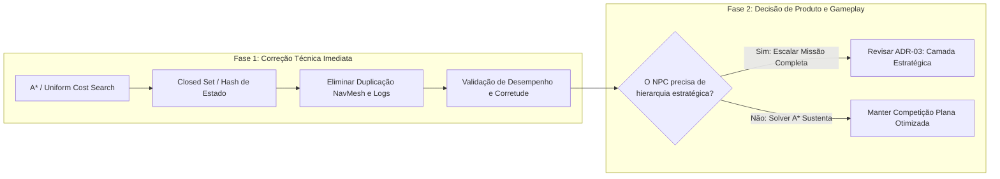
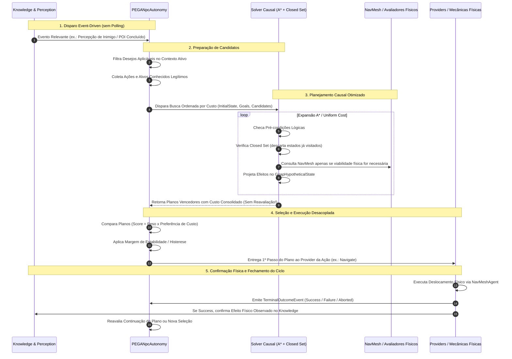

# Revisão da Arquitetura GOAP — Projeto PEGA

- **Documento:** Análise de Arquitetura de IA para Jogos
- **Data:** 2026-11-17
- **Escopo:** Autonomia dos NPCs larápios, solver causal, modelo de decisão e execução física
- **Status:** Proposta e Diagnóstico Técnico (Não altera GDD, MVP ou ADRs vigentes)

---

## 1. Diagnóstico Arquitetural

### 1.1 Fatos Observados no Repositório

1. **Separação de Fontes e Modelo Epistêmico (ADR-GOAP-02 e Código):**
   - O sistema separa formalmente `World State` (físico/Unity), `Knowledge State` (fatos conhecidos via escopos Individual, Group e Global) e `GoapHypotheticalState` (`IGoapHypotheticalStateView`).
   - O planejador causal parte exclusivamente do `Knowledge State` e de alvos legítimos (`IGoapKnownTarget`). Projeções hipotéticas não alteram o mundo nem o conhecimento (`GoapHypotheticalState.cs`).
   - Condições avaliam três valores lógicos: `True`, `False` e `Unknown` (`GoapConditionEvaluation.cs`).

2. **Algoritmo do Solver Atual (`GoapCausalPlanner.cs`):**
   - `SearchAlternatives` executa uma busca em largura (*Breadth-First Search* — BFS) irrestrita sobre uma fila de `SearchNode`.
   - **Ausência de conjunto fechado (Closed Set / Transposition Table):** O único critério de poda na expansão é `AreAllEffectsAlreadySatisfied`. Não há verificação de estados já visitados nem tabela hash de equivalência entre nós da fronteira.
   - Permutações de ações independentes geram ramificações combinatórias completas (ex.: aplicar A depois B gera ramo distinto de B depois A, ainda que o estado resultante seja semanticamente equivalente).

3. **Orquestração Multi-Desejo (`PEGANpcCausalPlanEvaluation.cs`):**
   - O método `Evaluate` itera sobre **todos** os `DesireConfiguration` aplicáveis no contexto ativo.
   - Para **cada Desejo**, instancia uma nova busca completa `planner.SearchAlternatives(...)` a partir da raiz (`initialState`), consumindo seu próprio teto de orçamento (`candidateEvaluationBudget`).

4. **Acoplamento Síncrono com NavMesh e Avaliação Redundante:**
   - Durante a busca BFS, a cada candidato que cumpre pré-condições, `SearchAlternatives` invoca `stepEvaluator.EvaluateActionStep`, que chama `EvaluateCausalStep`.
   - Se a ação exige navegação (`Contract.RequiresNavigation`), ela chama `NavigationSource.TryEstimateRoute` ou `TryEstimateRouteFrom` (`PEGANpcActionProviderAsset.cs`), executando `NavMesh.CalculatePath` ou `_agent.CalculatePath` e alocando uma instância de `NavMeshPath` (`PEGANpcNavMeshMovementIntentSource.cs`).
   - **Reavaliação duplicada:** Após a busca BFS concluir e retornar a lista `search.Alternatives`, o método `CreatePlanAlternatives` itera sobre todas as alternativas e **reexecuta `EvaluateCausalStep` passo a passo para cada ação de cada plano encontrado**, repetindo as consultas espaciais e de duração.

5. **Política de Pontuação nos Perfis:**
   - Todos os 8 perfis de Desejo ativos na pasta `Assets/PEGA/NPC/Desires/Profiles/` referenciam a mesma política: `PegaNpcPlanScore_Multiplicative.asset`.
   - A fórmula utilizada é estritamente:
     $$\text{costPreference} = \frac{1}{1 + \frac{\text{estimatedSeconds}}{\text{costReferenceSeconds}}}$$
     $$\text{score} = \text{effectiveDesireWeight} \times \text{costPreference}$$
   - Para um mesmo Desejo ($\text{effectiveDesireWeight}$ constante), maximizar o $\text{score}$ é matematicamente equivalente a minimizar $\text{estimatedSeconds}$.

6. **Overhead de Instrumentação de Diagnóstico (`PEGANpcAutonomy.cs`):**
   - Chamadas como `DescribeActionCandidates(providerCandidates)`, `DescribeViablePlans(...)` e `DescribeCausalSearches(...)` são avaliadas nos argumentos de métodos de log (ex.: `_log.Debug(..., LogFields.Field("candidates", DescribeActionCandidates(...)))`).
   - Em C#, as chamadas de concatenação (`StringBuilder`) e alocações de string ocorrem na pilha antes da entrada no método do logger, independentemente de a categoria ou nível de log estarem habilitados.

7. **Divergência de Composição na Cena (10 vs 11 Ações):**
   - Existem 11 assets de definição de ação em `Assets/PEGA/NPC/Actions/Definitions/`.
   - No documento `docs/superpowers/specs/2026-11-17-full-npc-variants-design.md`, verificou-se que `PickUpKnownIndividualObjectEntry.asset` compartilha o mesmo `ActionId` estável (`pick-up-known-object-entry`) com `PickUpKnownObjectEntry.asset` (Group).
   - Como `PEGANpcAutonomy` rejeita IDs duplicados na inicialização, a ação individual foi deliberadamente excluída da composição dos 3 NPCs em `MissionActivityContent.unity`, restando exatamente 10 ações ativas por Actor.

### 1.2 Inferências Técnicas

- **Causa Raiz do Esgotamento de Orçamento (`BudgetExhausted` 1024/1024):**
  Uma busca BFS cega com fator de ramificação $b \approx 12\text{--}18$ (10 ações combinadas com alvos legítimos) atinge $12^2 = 144$ nós no nível 2 e $12^3 = 1.728$ nós no nível 3. Como não há lista fechada para podar estados redundantes, a fila de busca satura o orçamento em profundidade rasa.
- **Concentração de Custo:**
  O impacto no frame rate observado decorreu do produto combinatório:
  $$\text{Custo Total} = N_{\text{NPCs}} \times \sum_{\text{Desejos}} (\text{Nós BFS} \times \text{NavMesh.CalculatePath} + \text{Alocações GC}) + \text{Formatação de Strings de Debug}$$
- **Responsabilidade Estrutural:**
  O GOAP atual tenta resolver no mesmo laço de busca a causalidade simbólica lógica e o cálculo geométrico contínuo. Como a busca não é orientada por custo, caminhos espaciais inviáveis ou subótimos são calculados exaustivamente antes de os caminhos curtos serem sequer selecionados.

---

## 2. O Dilema de Decisão: Competição no Mesmo Nível vs. Intenção Estratégica com Oportunidades Táticas

A pergunta central é: **todos os comportamentos devem competir como Desejos e planos no mesmo nível de seleção, ou o PEGA deve distinguir uma intenção estratégica contínua de oportunidades táticas locais?**

```mermaid
flowchart TD
    subgraph Modelo A: Competição Plana (Atual)
        D1[Desejo Investigar POIs] --> S1[Planner Causal]
        D2[Desejo Coleta Oportunística] --> S1
        D3[Desejo Atacar Player] --> S1
        D4[Desejo Fuga / Separação] --> S1
        S1 --> Sel1[Seleção Conjunta: Score = Peso x Preferência Custo]
        Sel1 --> Act1[Ação Vencedora]
    end

    subgraph Modelo B: Intenção Estratégica + Oportunidades Táticas
        IE[Intenção Estratégica: Circuito de POIs / Tesouro] --> Arb{Árbitro de Oportunidades / Gatilho}
        OT[Oportunidade Tática: Player Visto / Item Próximo] --> Arb
        Arb -->|Se Oportunidade Vencer Limiar| P_Tac[Plano Causal Tático: Combate / Coleta]
        Arb -->|Caso Contrário| P_Est[Plano Causal Estratégico: Navegação POI]
    end
```

### Comparação Sistemática das Duas Abordagens

| Dimensão | Modelo A: Competição Plana no Mesmo Nível (Contrato Vigente) | Modelo B: Intenção Estratégica com Oportunidades Táticas (Hierárquico / Duas Camadas) |
| :--- | :--- | :--- |
| **Premissa Conceitual** | Não existe superioridade prévia entre "estratégia" e "tática". Um ataque fácil e próximo pode pontuar mais que uma investigação distante; um item no chão desvia o NPC se o custo for baixo. | O NPC possui um "dever" contínuo (macro-objetivo da missão). Eventos pontuais desviam o NPC temporariamente sem que o macro-objetivo entre na disputa combinatorial do solver. |
| **Operação de Decisão** | A cada reavaliação (por evento), o planejador gera planos para todos os Desejos e os compara por fórmula única ($f(\text{peso}, \text{tempo})$). | O NPC mantém um estado de engajamento macro. Condições táticas (ex.: percepção do Player) disparam um ramo tático se superarem um limiar ou filtro utilitário. |
| **Complexidade do Solver** | Alta ($O(D \cdot b^d)$): O solver calcula planos completos para cada Desejo antes de saber se um deles tem chance real de vencer. | Baixa/Média: O solver planeja apenas para a intenção ativa ou para a oportunidade tática que passou pelo filtro de aplicabilidade. |
| **Estabilidade Comportamental** | Exige histerese cuidadosa na pontuação para evitar oscilação (*ping-pong*) entre investigar um POI a 15 metros e perseguir o Player a 14 metros. | Alta por construção: O NPC não abandona o objetivo estratégico a menos que a oportunidade tática atinja critérios formais de interrupção. |
| **Impacto Normativo (GDD e ADRs)** | **Totalmente aderente** ao GDD, ADR-GOAP-01, ADR-GOAP-02 e ADR-GOAP-03 (seleção conjunta, sem escolha prévia por peso). | **Requer revisão formal de ADR-GOAP-03 e GDD:** quebra a regra de que *o peso não escolhe o Desejo antes de considerar o custo das soluções*. |

### Impactos nos Contratos Vigentes Caso o Modelo B Seja Adotado

1. **Revisão de ADR-GOAP-03 (§2 e §Alternativas Consideradas):**
   - O ADR-GOAP-03 rejeitou expressamente: *"Escolher primeiro o Desejo de maior peso e depois procurar uma Action: rejeitada; pode ignorar custo, oportunidade e qualidade das soluções disponíveis."*
   - Uma camada estratégica precisaria redefinir essa restrição, formalizando que o macro-objetivo atua como **contexto de compromisso**, e não como um Desejo concorrente comum.
2. **Representação do Circuito de POIs vs. Tesouro da Fase:**
   - No modelo atual, o circuito de POIs é simulado artificialmente como uma sequência de Desejos de investigação que se desativam por aplicabilidade. No Modelo B, o circuito de POIs é uma máquina de objetivos estratégicos do arquétipo, enquanto o GOAP causal resolve apenas como navegar, transpor obstáculos e interagir com cada etapa.

---

## 3. Quatro Alternativas Arquiteturais Completas

### Alternativa 1: GOAP Causal Otimizado com Busca Ordenada (A* / Uniform Cost) e Deduplicação Semântica
*Preserva integralmente as regras do GDD e ADRs 01-03; moderniza o solver para a escala real do jogo.*

- **Autoria:** Idêntica à atual. Designers definem Desejos, pesos, perfis e ações com pré-condições e efeitos no Inspector.
- **Operação:** Orientada a eventos. O NPC avalia todos os Desejos aplicáveis conjuntamente.
- **Planejamento (Solver):**
  - Substituição da BFS por **Busca de Custo Uniforme (Dijkstra) ou A\***.
  - Como a política multiplicativa satisfaz a monotonicidade (menor tempo = maior score para o mesmo Desejo), expandir primeiro nós com menor tempo acumulado garante que a primeira solução encontrada para um Desejo seja a de maior score possível para aquele Desejo.
  - **Tabela de Transposição (Closed Set):** Cria-se uma chave canônica para `GoapHypotheticalState` baseada no conjunto ordenado de IDs de efeitos e alvos satisfeitos. Se dois ramos chegam ao mesmo estado de efeitos com tempo maior ou igual, o ramo redundante é podado imediatamente.
  - **Avaliação Preguiçosa (*Lazy Evaluation*) de NavMesh:** O cálculo de rota NavMesh **não** ocorre durante a expansão combinatória de pré-condições simbólicas. Ele é executado apenas quando um nó atinge o Goal ou quando a heurística exige precisão, utilizando distâncias euclidianas como limitante inferior admissível ($h(n) \le h^*(n)$).
- **Execução:** Idêntica à atual (providers físicos recebem o plano e executam).
- **Prós e Contras:**
  - *Prós:* Não altera nenhuma regra de gameplay; respeita todos os ADRs; elimina a maior parte do processamento inútil no solver.
  - *Contras:* Ainda exige disparar $N$ buscas para $N$ Desejos no mesmo frame se múltiplos Desejos estiverem aplicáveis.

---

### Alternativa 2: Arquitetura em Duas Camadas (Intenção Estratégica Persistente + Planner Causal Tático)
*Distingue compromisso de longo prazo de reações oportunísticas.*

- **Autoria:** Designers configuram um *Plano Diretor Estratégico* (circuito de patrulha, busca ao tesouro ou fuga) e um conjunto de *Oportunidades Táticas* (ataque, desarme, roubo rápido).
- **Operação:**
  - O NPC opera sob a Intenção Estratégica ativa até que um evento perceptivo relevante gere uma *Oportunidade Tática*.
  - A oportunidade passa por um filtro de custo-benefício pré-planejamento (ex.: distância euclidiana do jogador < raio de engajamento). Se aprovada, suspende a intenção estratégica e assume o controle.
- **Planejamento (Solver):**
  - O GOAP causal nunca roda para o circuito inteiro; ele planeja apenas a resolução tática imediata (ex.: `Aproximar -> Atacar` ou `Navegar -> Coletar Item`).
  - O macro-objetivo (circuito de POIs ou busca do tesouro) é mantido por um coordenador hierárquico (HTN leve ou Sequenciador de Metas).
- **Execução:** A execução física permanece sob os mesmos providers. A retomada da intenção estratégica após interrupção tática revalida o ponto do circuito mais próximo.
- **Prós e Contras:**
  - *Prós:* Escalabilidade altíssima; comportamento de longo prazo previsível e robusto; sem explosão combinatória.
  - *Contras:* Exige emendar o ADR-GOAP-03; rompe a igualdade pura de competição entre Desejos; requer lógica de retomada de tarefas interrompidas.

---

### Alternativa 3: GOAP Multi-Goal Unificado com Busca Causal Compartilhada
*Uma única busca causal resolve múltiplos Desejos simultaneamente.*

- **Autoria:** Idêntica à atual.
- **Operação:** Orientada a eventos.
- **Planejamento (Solver):**
  - Em vez de rodar $N$ buscas BFS/A* independentes a partir da raiz para cada Desejo, o solver roda **uma única busca para a frente** (*forward search*) a partir do estado atual.
  - A fronteira de busca testa simultaneamente se o estado hipotético expandido satisfaz a condição de término de **qualquer** um dos Desejos aplicáveis.
  - Como os custos temporais das ações são acumulados do ponto de partida físico comum, a busca explora os estados mais acessíveis primeiro para todas as metas de uma só vez.
- **Execução:** Sem alterações nos providers.
- **Prós e Contras:**
  - *Prós:* Elimina a redundância de explorar a vizinhança de ações e alvos $N$ vezes a partir do mesmo estado inicial; mantém a compatibilidade formal com a competição conjunta de Desejos.
  - *Contras:* A comparação de prioridades entre Desejos com pesos muito discrepantes na fronteira exige uma função de ordenação normalizada no nó da busca.

---

### Alternativa 4: Pré-Filtro Utilitário Rápido com Planejamento Causal Sob Demanda
*Seleção utilitária de intenção candidata antes do cálculo causal.*

- **Autoria:** Desejos mantêm curvas de utilidade baseadas em contexto e proximidade estimada.
- **Operação:** Diante de um evento, o sistema calcula a utilidade aproximada de cada Desejo usando heurísticas baratas (sem NavMesh).
- **Planejamento (Solver):**
  - O GOAP causal só é invocado para o Desejo de maior utilidade estimada.
  - Se o GOAP retornar `NoKnownSolution`, o sistema tenta o segundo colocado na lista utilitária.
- **Execução:** Idêntica.
- **Prós e Contras:**
  - *Prós:* Reduz o número de buscas causais para 1 na imensa maioria dos frames.
  - *Contras:* Conflita diretamente com o ADR-GOAP-03, que rejeitou descartar Desejos antes de encontrar suas soluções. Se o plano do Desejo preferido for subitamente bloqueado, o tempo de fallback pode gerar latência de decisão.

---

## 4. Recomendação Arquitetural e Trade-offs

### Direção Recomendada: Abordagem Híbrida Evolutiva (Alternativa 1 com Transição Estruturada para Alternativa 2)

Recomenda-se uma estratégia em **duas fases bem delimitadas**, separando estritamente **otimização técnica sem quebra de contrato** de **revisão de gameplay**:



### Justificativa da Escolha

1. **Curto Prazo (Otimização Técnica Pura — Sem alterar GDD/ADRs):**
   - A queda de FPS e os 358 registros de `BudgetExhausted` **não decorrem de uma falha conceitual do GOAP**, mas sim da implementação ingênua do solver: busca BFS cega, sem conjunto fechado, com consultas síncronas ao NavMesh a cada expansão, reavaliação redundante no cálculo de score e interpolação pesada de strings em diagnósticos.
   - Corrigir o solver com **A* / Uniform Cost**, **Closed Set** e **eliminação da reavaliação de NavMesh** preservará 100% dos contratos vigentes do GDD e ADRs 01, 02 e 03, restaurando a taxa de quadros e permitindo validar os comportamentos pretendidos para os 3 NPCs.

2. **Médio/Longo Prazo (Decisão de Produto sobre a Intenção Estratégica):**
   - Para o **circuito de POIs da validação atual**, o modelo de Desejos concorrentes funciona bem após a otimização técnica.
   - No entanto, para a **missão completa do jogo** (disputa pelo tesouro da fase, rota de fuga complexa, papéis da gangue), tratar o objetivo da fase inteira como um Desejo concorrendo a cada passo contra "coletar moeda no chão" gerará fragilidade comportamental ou necessitará de pesos artificiais descalibrados.
   - Assim que a Fase 1 for estabilizada, recomenda-se que a equipe de design formalize a distinção entre **Objetivo de Missão (Estratégico)** e **Ações Táticas Oportunísticas**, atualizando o ADR-GOAP-03 com respaldo formal de gameplay.

---

## 5. Desenho de Ponta a Ponta do Sistema Proposto



### Detalhamento das Etapas

1. **Configuração de Contexto e Desejos (Autoria):**
   - O designer configura `PegaNpcDesireProfile`. Cada contexto (`Normal`, `Contingency`, `Escape`) contém seus `DesireConfiguration` com condições de aplicabilidade sobre o `Knowledge State`.
2. **Geração de Candidatos (Sem Polling):**
   - Quando um evento de conhecimento ocorre (novo alvo visto, perda de alvo, conclusão de ação), a autonomia reúne os alvos conhecidos (`PegaNpcGoapKnownTarget`) e solicita aos providers instanciados as ações compatíveis.
3. **Planejamento Causal e Poda:**
   - O solver avalia os nós na fila de prioridade ordenada por menor tempo acumulado $\sum \text{seconds}$.
   - O `Closed Set` evita recalcular sequências redundantes.
   - O resultado da estimativa de rota obtido durante a expansão é armazenado no próprio nó do plano; **elimina-se a reavaliação redundante pós-busca**.
4. **Seleção e Estabilidade:**
   - O seletor calcula o `Score` usando a política multiplicativa validada.
   - Aplica a margem de histerese (estabilidade de intenção do ADR-GOAP-03): uma intenção ativa só é trocada se o score da nova alternativa superar o da atual por uma margem configurada.
5. **Execução e Fechamento Causal:**
   - O primeiro passo do plano é despachado para o provider concreto (ex.: `PEGANpcInvestigateKnownGroupPoiAction`).
   - O provider comanda o `PEGANpcNavMeshMovementIntentSource` ou a mecânica de ataque/interação existente.
   - Ao concluir fisicamente, o provider valida o efeito observado (`TryGetObservedEffect`). Se válido, o efeito é publicado como fato legítimo no `Knowledge State`, disparando a reavaliação event-driven.

---

## 6. Plano de Investigação e Validação

### 6.1 Dúvidas Técnicas e de Gameplay a Sanar Primeiro

1. **Correção da Ação de Coleta Duplicada:**
   - Corrigir a sobreposição de `ActionId` entre `PickUpKnownIndividualObjectEntry` e `PickUpKnownObjectEntry` (atribuindo IDs estáveis distintos, ex.: `pick-up-known-group-object-entry`), permitindo que a composição completa com 11 ações seja finalmente instanciada e testada nos 3 NPCs.
2. **Overhead Isolado dos Diagnósticos:**
   - Envolver chamadas a `DescribeActionCandidates`, `DescribeViablePlans` e `DescribeCausalSearches` em checagens `if (_log.IsDebugEnabled)` ou delegates lazy para medir o ganho de CPU exclusivamente atribuível à eliminação de strings de log.
3. **Comportamento Observável da Busca A\* vs. BFS:**
   - Provar se a busca ordenada por custo encontra exatamente as mesmas alternativas prioritárias que a BFS encontrava, com uma fração dos nós expandidos.

### 6.2 Protocolo de Medição Comparativa no Unity Editor

> [!IMPORTANT]
> As medições abaixo devem ser realizadas manualmente no Unity Profiler / Play Mode pelo desenvolvedor, sem uso de batchmode ou testes automatizados não autorizados, conforme as regras do projeto.

| Cenário de Teste | Configuração do Solver | Métricas a Coletar no Profiler | Critério de Aceitação |
| :--- | :--- | :--- | :--- |
| **Baseline Atual** | BFS Cega, Orçamento = 128, Logs Atuais | CPU Time por frame, Chamadas `NavMesh.CalculatePath`, GC Alloc (KB/frame), Ocorrências de `BudgetExhausted` | Ponto de partida documental |
| **Experimento A: Limpeza de Diagnóstico** | BFS Cega, Orçamento = 128, Logs protegidos por checagem condicional | GC Alloc e tempo de CPU no laço de autonomia | Redução mensurável de alocações de memória temporária |
| **Experimento B: Solver Ordenado + Closed Set** | A* / Uniform Cost, Closed Set, Orçamento = 128 | Número de nós avaliados, chamadas NavMesh por decisão, taxa de `PlanFound` vs `BudgetExhausted` | Zero `BudgetExhausted` em condições normais; tempo de planejamento < 1.0 ms |
| **Experimento C: Validação de Gameplay com 11 Ações** | Solver Otimizado, 3 NPCs com 11 Ações ativas | Comportamento no Play Mode: cumprimento do circuito de POIs, reação ao Player, ataques e coletas | NPC realiza transições suaves entre patrulha, combate e coleta sem oscilação |

---

## 7. Riscos e Critérios de Sucesso

### 7.1 Matriz de Riscos

| Risco | Impacto | Mitigação Arquitetural |
| :--- | :--- | :--- |
| **Poda Falsa no Closed Set** | O planner descarta um caminho que parecia igual mas tinha diferenças em alvos dinâmicos. | A chave de estado do nó deve incluir obrigatoriamente a tupla ordenada: `(EfeitoId, TargetId, TargetPositionHash)`. Não usar apenas hash do estado booleano global. |
| **Oscilação de Decisão (*Thrashing*)** | NPC troca de meta a cada passo se os scores de dois Desejos forem parecidos. | Implementar rigorosamente a margem de histerese de intenção (ADR-03): só trocar de plano se `ScoreNovo > ScoreAtual * (1 + Margem)`. |
| **Ruptura de Contrato de Gameplay** | Tentar "consertar" o frame rate podando Desejos arbitrariamente e criando comportamento cego. | Seguir estritamente a recomendação da Fase 1: otimizar a mecânica do solver sem alterar a semântica causal ou as regras de concorrência de Desejos. |
| **Divergência de NavMesh em Projeções** | O custo estimado em estado projetado diverge da realidade física quando o NPC atinge a posição. | O provider de ação deve continuar revalidando o caminho na execução física; falha na rota aciona `Aborted` e força replanejamento legítimo. |

### 7.2 Critérios de Sucesso

1. **Clareza de Autoria:** O designer define arquétipos manipulando apenas pesos de Desejo, thresholds de aplicabilidade e referências de tempo no Inspector, sem necessitar ajustar parâmetros de baixo nível do solver (como orçamentos artificiais de nós).
2. **Legibilidade Comportamental:** O NPC conclui trajetos entre POIs de forma consistente, reage a itens no caminho sem hesitar e desvia para o combate quando o Player se aproxima, retomando o circuito após a perda de contato.
3. **Corretude Causal:** O sistema distingue claramente em seus relatórios os estados `PlanFound`, `NoKnownSolution` e `BudgetExhausted`, operando em regime estável sem exaustão de orçamento.
4. **Desacoplamento e Escalabilidade:** O tempo total gasto por frame na autonomia GOAP dos 3 NPCs permanece inferior a 1,5 ms no Unity Profiler, com capacidade demonstrada de escalar para novos arquétipos e instâncias adicionais sem degradação exponencial de desempenho.
